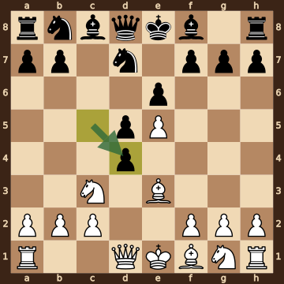
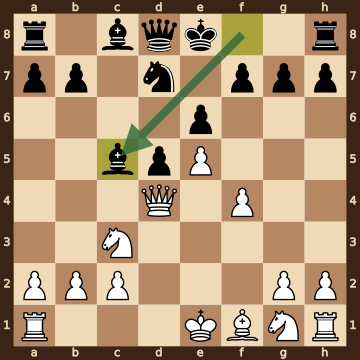
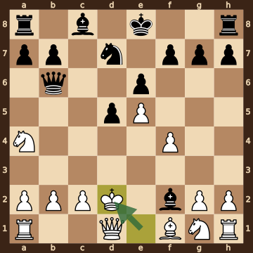
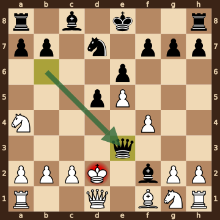

Abbate,Giovanni (1668) – Dowd,Patrick (1819) · 36th NATO Chess 2026, round 4.58, 2026.10.14. The game ends in checkmate on move 12. [Download the PGN](game.pgn)

Read each step's moves, play them **in your head** (no board!), then click the cards to check yourself. Board pictures only appear inside the answers — and once, after step 2.



### Step 1 · Moves 1–3




| | Pawns (moved ones in **bold**) | Count |
|---|---|---|
| White | a2 b2 c2 **d3** **e4** f2 g2 h2 | 8 |
| Black | a7 b7 c7 **d5** **e6** f7 g7 h7 | 8 |

In the center (c- to f-files, ranks 3–6): White d3 e4; Black d5 e6.



**White:** knight **c3**.

**Black:** knight **f6**.


### Step 2 · Moves 4–6




| | Pawns (moved ones in **bold**) | Count |
|---|---|---|
| White | a2 b2 c2 **e5** f2 g2 h2 | 7 |
| Black | a7 b7 **d4** **d5** **e6** f7 g7 h7 | 8 |

In the center (c- to f-files, ranks 3–6): White e5; Black d4 d5 e6.



**White:** bishop **e3**, knight **c3**.

**Black:** knight **d7**.

Gone from the board: White has lost 1 pawn.



**White king: e1** — still on its starting square, not castled.

**Black king: e8** — still on its starting square, not castled.



**No file is fully open** — every file still has a pawn on it.

Half open for White (only a Black pawn on it): d-file.

Half open for Black (only a White pawn on it): c-file.


**Check your picture** — the position after 6...cxd4:

### Step 3 · Moves 7–9




| | White | Black |
|---|---|---|
| Pawns | a2 b2 c2 e5 f4 g2 h2 | a7 b7 d5 e6 f7 g7 h7 |
| Knights | c3 g1 | d7 |
| Bishops | f1 | c5 c8 |
| Rooks | a1 h1 | a8 h8 |
| Queen | d4 | d8 |
| King | e1 | e8 |




White's king is on **e1**.

Its own pieces close by: bishop **f1**, knight **c3**, knight **g1**, pawn **c2**, pawn **g2**.

Black pieces close by: none.

Squares next to the king that Black already hits: none.



**7.Bxd4** took a pawn on d4.

**8...Nxd4** took a bishop on d4.

**9.Qxd4** took a knight on d4.


### Step 4 · Moves 10–12




| | White | Black |
|---|---|---|
| Pawns | a2 b2 c2 e5 f4 g2 h2 | a7 b7 d5 e6 f7 g7 h7 |
| Knights | a4 g1 | d7 |
| Bishops | f1 | c8 f2 |
| Rooks | a1 h1 | a8 h8 |
| Queen | d1 | b6 |
| King | d2 | e8 |




**Material is equal.**

| | Pieces | Points |
|---|---|---|
| White | Q, 2R, B, 2N, 7 pawns | 35 |
| Black | Q, 2R, 2B, N, 7 pawns | 35 |

(Pawn 1, knight 3, bishop 3, rook 5, queen 9.)



White's king is on **d2**.

Its own pieces close by: queen **d1**, bishop **f1**, pawn **b2**, pawn **c2**, pawn **f4**.

Black pieces close by: bishop **f2**.

Squares next to the king that Black already hits: e1 (bishop f2); e3 (bishop f2, queen b6).


### Final question




Check from the queen on e3.

The White king on d2 has no square to go to:

- **c1** — covered by the queen on e3
- **c2** — blocked by its own pawn
- **c3** — covered by the queen on e3
- **d1** — blocked by its own queen
- **d3** — covered by the queen on e3
- **e1** — covered by the queen on e3 and the bishop on f2
- **e2** — covered by the queen on e3
- **e3** — the Black queen stands there, protected by the bishop on f2

The king can't take the queen — it is protected by the bishop on f2.


