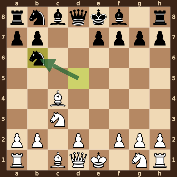
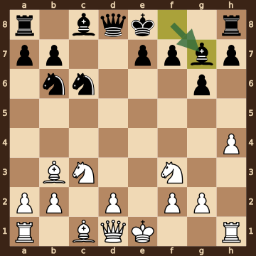
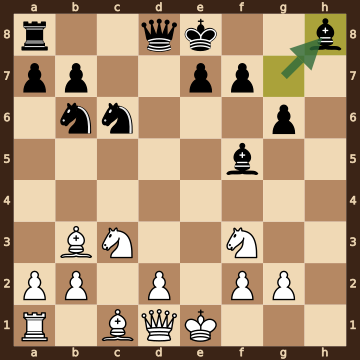
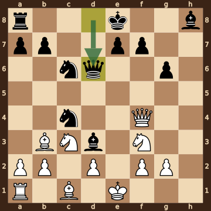
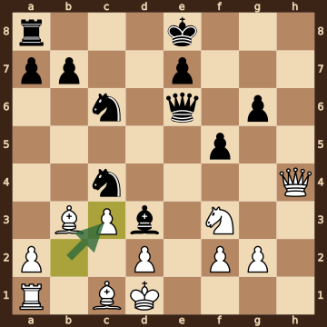
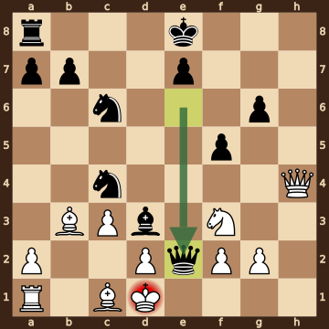

Angeles Vera,Mario Alberto (1985) – Darini,P (2382) · Titled Tue 13th Oct 2026, round 1, 2026.10.13. The game ends in checkmate on move 19. [Download the PGN](game.pgn)

Read each step's moves, play them **in your head** (no board!), then click the cards to check yourself. Board pictures only appear inside the answers — and once, after step 2.



### Step 1 · Moves 1–3




| | Pawns (moved ones in **bold**) | Count |
|---|---|---|
| White | a2 b2 d2 **e4** f2 g2 h2 | 7 |
| Black | a7 b7 **d5** e7 f7 g7 h7 | 7 |

In the center (c- to f-files, ranks 3–6): White e4; Black d5.



**White:** nothing yet.

**Black:** nothing yet.

Gone from the board: White has lost 1 pawn; Black has lost 1 pawn.


### Step 2 · Moves 4–6




| | Pawns (moved ones in **bold**) | Count |
|---|---|---|
| White | a2 b2 d2 f2 g2 h2 | 6 |
| Black | a7 b7 e7 f7 g7 h7 | 6 |

In the center (c- to f-files, ranks 3–6): White none; Black none.



**White:** bishop **c4**, knight **c3**.

**Black:** knight **b6**.

Gone from the board: White has lost 2 pawns; Black has lost 2 pawns.



**White king: e1** — still on its starting square, not castled.

**Black king: e8** — still on its starting square, not castled.



**Open files** (no pawns at all): c-file.

Half open for White (only a Black pawn on it): e-file.

Half open for Black (only a White pawn on it): d-file.


**Check your picture** — the position after 6...Nb6:

### Step 3 · Moves 7–9




| | White | Black |
|---|---|---|
| Pawns | a2 b2 d2 f2 g2 h4 | a7 b7 e7 f7 g6 h7 |
| Knights | c3 f3 | b6 c6 |
| Bishops | b3 c1 | c8 g7 |
| Rooks | a1 h1 | a8 h8 |
| Queen | d1 | d8 |
| King | e1 | e8 |




White's king is on **e1**.

Its own pieces close by: queen **d1**, bishop **c1**, knight **c3**, knight **f3**, pawn **d2**, pawn **f2**, pawn **g2**.

Black pieces close by: none.

Squares next to the king that Black already hits: d2 (queen d8).



**White:** king **e1**, queen **d1**, rook **a1**, rook **h1**, bishop **c1**. Pawns still at home: a2 b2 d2 f2 g2.

**Black:** king **e8**, queen **d8**, rook **a8**, rook **h8**, bishop **c8**. Pawns still at home: a7 b7 e7 f7 h7.


### Step 4 · Moves 10–12




| | White | Black |
|---|---|---|
| Pawns | a2 b2 d2 f2 g2 | a7 b7 e7 f7 g6 |
| Knights | c3 f3 | b6 c6 |
| Bishops | b3 c1 | f5 h8 |
| Rooks | a1 | a8 |
| Queen | d1 | d8 |
| King | e1 | e8 |




**Material is equal.**

| | Pieces | Points |
|---|---|---|
| White | Q, R, 2B, 2N, 5 pawns | 31 |
| Black | Q, R, 2B, 2N, 5 pawns | 31 |

(Pawn 1, knight 3, bishop 3, rook 5, queen 9.)



**White king: e1** — still on its starting square, not castled.

**Black king: e8** — still on its starting square, not castled.


### Step 5 · Moves 13–15




| | White | Black |
|---|---|---|
| Pawns | a2 b2 d2 f2 g2 | a7 b7 e7 f7 g6 |
| Knights | c3 f3 | c4 c6 |
| Bishops | b3 c1 | d3 h8 |
| Rooks | a1 | a8 |
| Queen | f4 | d6 |
| King | e1 | e8 |




**Open files** (no pawns at all): c-file, h-file.

Half open for White (only a Black pawn on it): e-file.

Half open for Black (only a White pawn on it): d-file.



**White:** king **e1**, rook **a1**, bishop **c1**. Pawns still at home: a2 b2 d2 f2 g2.

**Black:** king **e8**, rook **a8**. Pawns still at home: a7 b7 e7 f7.


### Step 6 · Moves 16–19




| | White | Black |
|---|---|---|
| Pawns | a2 c3 d2 f2 g2 | a7 b7 e7 f5 g6 |
| Knights | f3 | c4 c6 |
| Bishops | b3 c1 | d3 |
| Rooks | a1 | a8 |
| Queen | h4 | e6 |
| King | d1 | e8 |




**Material is equal.**

| | Pieces | Points |
|---|---|---|
| White | Q, R, 2B, N, 5 pawns | 28 |
| Black | Q, R, B, 2N, 5 pawns | 28 |

(Pawn 1, knight 3, bishop 3, rook 5, queen 9.)



White's king is on **d1**.

Its own pieces close by: bishop **b3**, bishop **c1**, knight **f3**, pawn **c3**, pawn **d2**, pawn **f2**.

Black pieces close by: bishop **d3**.

Squares next to the king that Black already hits: c2 (bishop d3); d2 (knight c4); e1 (queen e6); e2 (bishop d3, queen e6).


### Final question




Check from the queen on e2.

The White king on d1 has no square to go to:

- **c1** — blocked by its own bishop
- **c2** — covered by the bishop on d3
- **d2** — blocked by its own pawn
- **e1** — covered by the queen on e2
- **e2** — the Black queen stands there, protected by the bishop on d3

The king can't take the queen — it is protected by the bishop on d3.


