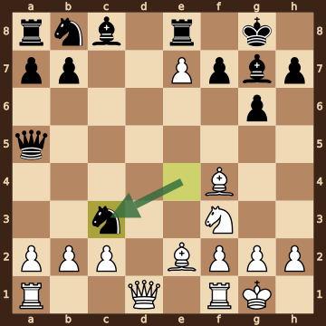
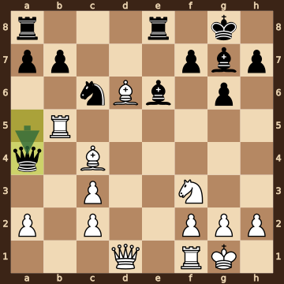
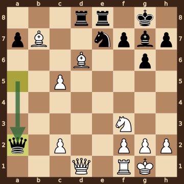
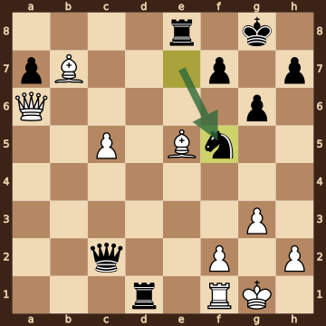
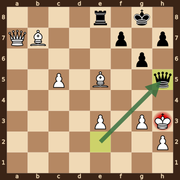
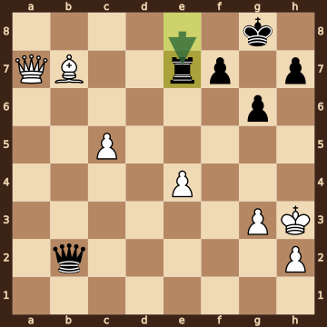
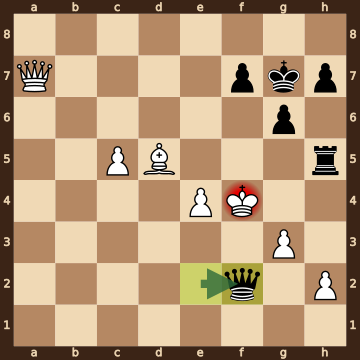
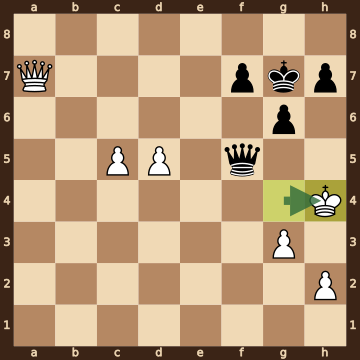
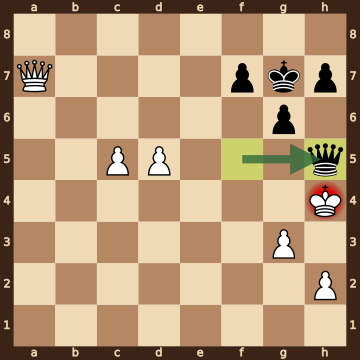

Aradhya,Garg (2430) – Kazhgaleyev,M (2541) · Atyrau Chess Masters Open, round 5.5, 2026.10.16. The game ends in checkmate on move 43. [Download the PGN](game.pgn)

Read each step's moves, play them **in your head** (no board!), then click the cards to check yourself. Board pictures only appear inside the answers — and once, after step 2.



### Step 1 · Moves 1–5




| | Pawns (moved ones in **bold**) | Count |
|---|---|---|
| White | a2 b2 c2 **d4** **e4** f2 g2 h2 | 8 |
| Black | a7 b7 c7 **d6** e7 f7 **g6** h7 | 8 |

In the center (c- to f-files, ranks 3–6): White d4 e4; Black d6.



**White:** bishop **f4**, knight **c3**, knight **f3**.

**Black:** king **g8**, rook **f8**, bishop **g7**, knight **f6**.


### Step 2 · Moves 6–10




| | Pawns (moved ones in **bold**) | Count |
|---|---|---|
| White | a2 b2 c2 **e7** f2 g2 h2 | 7 |
| Black | a7 b7 f7 **g6** h7 | 5 |

In the center (c- to f-files, ranks 3–6): White none; Black none.



**White:** king **g1**, rook **f1**, bishop **e2**, bishop **f4**, knight **f3**.

**Black:** king **g8**, queen **a5**, rook **e8**, bishop **g7**, knight **c3**.

Gone from the board: White has lost 1 knight, 1 pawn; Black has lost 3 pawns.



**White king: g1** — castled kingside.

**Black king: g8** — castled kingside.



**Open files** (no pawns at all): d-file.

Half open for Black (only a White pawn on it): c-file, e-file.

Already on an open file: White queen d1.


**Check your picture** — the position after 10...Nxc3:

### Step 3 · Moves 11–15




| | White | Black |
|---|---|---|
| Pawns | a2 c2 c3 f2 g2 h2 | a7 b7 f7 g6 h7 |
| Knights | f3 | c6 |
| Bishops | c4 d6 | e6 g7 |
| Rooks | b5 f1 | a8 e8 |
| Queen | d1 | a4 |
| King | g1 | g8 |




White's king is on **g1**.

Its own pieces close by: rook **f1**, knight **f3**, pawn **f2**, pawn **g2**, pawn **h2**.

Black pieces close by: none.

Squares next to the king that Black already hits: none.



**11.bxc3** took a knight on c3.

**11...Rxe7** took a pawn on e7.


### Step 4 · Moves 16–20




| | White | Black |
|---|---|---|
| Pawns | c2 c5 f2 g2 h2 | a7 f7 g6 h7 |
| Knights | f3 | e7 |
| Bishops | b7 d6 | g7 |
| Rooks | f1 | d8 e8 |
| Queen | d1 | a2 |
| King | g1 | g8 |




**Black is ahead by 1 point.**

| | Pieces | Points |
|---|---|---|
| White | Q, R, 2B, N, 5 pawns | 28 |
| Black | Q, 2R, B, N, 4 pawns | 29 |

(Pawn 1, knight 3, bishop 3, rook 5, queen 9.)



**White king: g1** — castled kingside.

**Black king: g8** — castled kingside.


### Step 5 · Moves 21–25




| | White | Black |
|---|---|---|
| Pawns | c5 f2 g3 h2 | a7 f7 g6 h7 |
| Knights | — | f5 |
| Bishops | b7 e5 | — |
| Rooks | f1 | d1 e8 |
| Queen | a6 | c2 |
| King | g1 | g8 |




**Open files** (no pawns at all): b-file, d-file, e-file.

Half open for White (only a Black pawn on it): a-file.

Half open for Black (only a White pawn on it): c-file.

Already on an open file: Black rook d1, Black rook e8.



**White:** none — every piece has moved. Pawns still at home: f2 h2.

**Black:** none — every piece has moved. Pawns still at home: a7 f7 h7.


### Step 6 · Moves 26–30




| | White | Black |
|---|---|---|
| Pawns | c5 e3 g3 h2 | f7 g6 h7 |
| Knights | — | — |
| Bishops | b7 e5 | — |
| Rooks | — | e8 |
| Queen | a7 | h5 |
| King | h3 | g8 |




White's king is on **h3**.

Its own pieces close by: pawn **g3**, pawn **h2**.

Black pieces close by: queen **h5**.

Squares next to the king that Black already hits: g4 (queen h5); h4 (queen h5).



**26.Qxa7** took a pawn on a7.

**26...Rxf1+** took a rook on f1.

**27.Kxf1** took a rook on f1.

**29.fxe3** took a knight on e3.


### Step 7 · Moves 31–35




| | White | Black |
|---|---|---|
| Pawns | c5 e4 g3 h2 | f7 g6 h7 |
| Knights | — | — |
| Bishops | b7 | — |
| Rooks | — | e7 |
| Queen | a7 | b2 |
| King | h3 | g8 |




**Black is ahead by 1 point.**

| | Pieces | Points |
|---|---|---|
| White | Q, B, 4 pawns | 16 |
| Black | Q, R, 3 pawns | 17 |

(Pawn 1, knight 3, bishop 3, rook 5, queen 9.)



**White king: h3** — castled kingside.

**Black king: g8** — castled kingside.


### Step 8 · Moves 36–40




| | White | Black |
|---|---|---|
| Pawns | c5 e4 g3 h2 | f7 g6 h7 |
| Knights | — | — |
| Bishops | d5 | — |
| Rooks | — | h5 |
| Queen | a7 | f2 |
| King | f4 | g7 |




**Open files** (no pawns at all): a-file, b-file, d-file.

Half open for White (only a Black pawn on it): f-file.

Half open for Black (only a White pawn on it): c-file, e-file.

Already on an open file: White queen a7.



**White:** none — every piece has moved. Pawns still at home: h2.

**Black:** none — every piece has moved. Pawns still at home: f7 h7.


### Step 9 · Moves 41–43




| | White | Black |
|---|---|---|
| Pawns | c5 d5 g3 h2 | f7 g6 h7 |
| Knights | — | — |
| Bishops | — | — |
| Rooks | — | — |
| Queen | a7 | f5 |
| King | h4 | g7 |




**White is ahead by 1 point.**

| | Pieces | Points |
|---|---|---|
| White | Q, 4 pawns | 13 |
| Black | Q, 3 pawns | 12 |

(Pawn 1, knight 3, bishop 3, rook 5, queen 9.)



White's king is on **h4**.

Its own pieces close by: pawn **g3**, pawn **h2**.

Black pieces close by: queen **f5**, pawn **g6**.

Squares next to the king that Black already hits: g4 (queen f5); g5 (queen f5); h3 (queen f5); h5 (queen f5, pawn g6).


### Final question




Check from the queen on h5.

The White king on h4 has no square to go to:

- **g3** — blocked by its own pawn
- **g4** — covered by the queen on h5
- **g5** — covered by the queen on h5
- **h3** — covered by the queen on h5
- **h5** — the Black queen stands there, protected by the pawn on g6

The king can't take the queen — it is protected by the pawn on g6.


