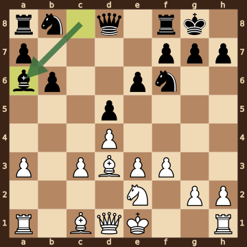
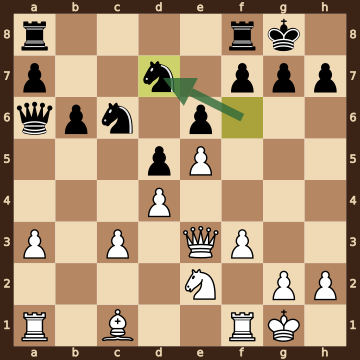
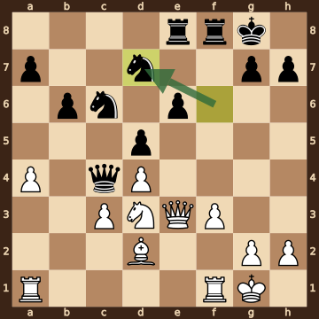
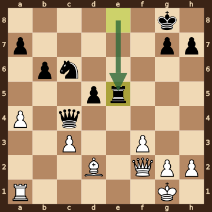
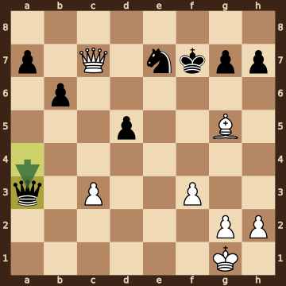
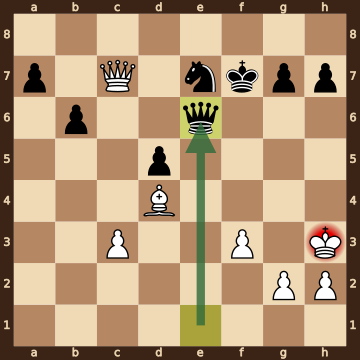
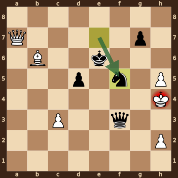
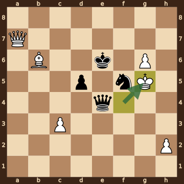
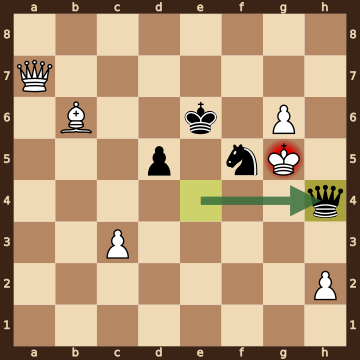

Bardyk,Artem (2390) – Khubukshanov,Erdem (2508) · Atyrau Chess Masters Open, round 5.29, 2026.10.16. The game ends in checkmate on move 44. [Download the PGN](game.pgn)

Read each step's moves, play them **in your head** (no board!), then click the cards to check yourself. Board pictures only appear inside the answers — and once, after step 2.



### Step 1 · Moves 1–5




| | Pawns (moved ones in **bold**) | Count |
|---|---|---|
| White | a2 b2 **c4** **d4** **e3** f2 g2 h2 | 8 |
| Black | a7 b7 c7 **d5** **e6** f7 g7 h7 | 8 |

In the center (c- to f-files, ranks 3–6): White c4 d4 e3; Black d5 e6.



**White:** bishop **d3**, knight **c3**.

**Black:** king **g8**, rook **f8**, bishop **b4**, knight **f6**.


### Step 2 · Moves 6–10




| | Pawns (moved ones in **bold**) | Count |
|---|---|---|
| White | **a3** **c3** **d4** **e3** **f3** g2 h2 | 7 |
| Black | a7 **b6** **d5** **e6** f7 g7 h7 | 7 |

In the center (c- to f-files, ranks 3–6): White c3 d4 e3 f3; Black d5 e6.



**White:** bishop **d3**, knight **e2**.

**Black:** king **g8**, rook **f8**, bishop **a6**, knight **f6**.

Gone from the board: White has lost 1 knight, 1 pawn; Black has lost 1 bishop, 1 pawn.



**White king: e1** — still on its starting square, not castled.

**Black king: g8** — castled kingside.



**No file is fully open** — every file still has a pawn on it.

Half open for White (only a Black pawn on it): b-file.

Half open for Black (only a White pawn on it): c-file.


**Check your picture** — the position after 10...Ba6:

### Step 3 · Moves 11–15




| | White | Black |
|---|---|---|
| Pawns | a3 c3 d4 e5 f3 g2 h2 | a7 b6 d5 e6 f7 g7 h7 |
| Knights | e2 | c6 d7 |
| Bishops | c1 | — |
| Rooks | a1 f1 | a8 f8 |
| Queen | e3 | a6 |
| King | g1 | g8 |




White's king is on **g1**.

Its own pieces close by: queen **e3**, rook **f1**, knight **e2**, pawn **f3**, pawn **g2**, pawn **h2**.

Black pieces close by: none.

Squares next to the king that Black already hits: none.



**12...Bxd3** took a bishop on d3.

**13.Qxd3** took a bishop on d3.


### Step 4 · Moves 16–20




| | White | Black |
|---|---|---|
| Pawns | a4 c3 d4 f3 g2 h2 | a7 b6 d5 e6 g7 h7 |
| Knights | d3 | c6 d7 |
| Bishops | d2 | — |
| Rooks | a1 f1 | e8 f8 |
| Queen | e3 | c4 |
| King | g1 | g8 |




**Material is equal.**

| | Pieces | Points |
|---|---|---|
| White | Q, 2R, B, N, 6 pawns | 31 |
| Black | Q, 2R, 2N, 6 pawns | 31 |

(Pawn 1, knight 3, bishop 3, rook 5, queen 9.)



**White king: g1** — castled kingside.

**Black king: g8** — castled kingside.


### Step 5 · Moves 21–25




| | White | Black |
|---|---|---|
| Pawns | a4 c3 f3 g2 h2 | a7 b6 d5 g7 h7 |
| Knights | — | c6 |
| Bishops | d2 | — |
| Rooks | a1 | e5 |
| Queen | f2 | c4 |
| King | g1 | g8 |




**Open files** (no pawns at all): e-file.

Half open for White (only a Black pawn on it): b-file, d-file.

Half open for Black (only a White pawn on it): c-file, f-file.

Already on an open file: Black rook e5.



**White:** rook **a1**. Pawns still at home: g2 h2.

**Black:** none — every piece has moved. Pawns still at home: a7 g7 h7.


### Step 6 · Moves 26–30




| | White | Black |
|---|---|---|
| Pawns | c3 f3 g2 h2 | a7 b6 d5 g7 h7 |
| Knights | — | e7 |
| Bishops | g5 | — |
| Rooks | — | — |
| Queen | c7 | a3 |
| King | g1 | f7 |




White's king is on **g1**.

Its own pieces close by: pawn **f3**, pawn **g2**, pawn **h2**.

Black pieces close by: none.

Squares next to the king that Black already hits: none.



**26...Rxe1+** took a rook on e1.

**27.Qxe1** took a rook on e1.

**28...Qxa4** took a pawn on a4.


### Step 7 · Moves 31–35




| | White | Black |
|---|---|---|
| Pawns | c3 f3 g2 h2 | a7 b6 d5 g7 h7 |
| Knights | — | e7 |
| Bishops | d4 | — |
| Rooks | — | — |
| Queen | c7 | e6 |
| King | h3 | f7 |




**Black is ahead by 1 point.**

| | Pieces | Points |
|---|---|---|
| White | Q, B, 4 pawns | 16 |
| Black | Q, N, 5 pawns | 17 |

(Pawn 1, knight 3, bishop 3, rook 5, queen 9.)



**White king: h3** — castled kingside.

**Black king: f7** — castled kingside.


### Step 8 · Moves 36–40




| | White | Black |
|---|---|---|
| Pawns | c3 h2 h5 | d5 g7 |
| Knights | — | f5 |
| Bishops | b6 | — |
| Rooks | — | — |
| Queen | a7 | f3 |
| King | h4 | e6 |




**Open files** (no pawns at all): a-file, b-file, e-file, f-file.

Half open for White (only a Black pawn on it): d-file, g-file.

Half open for Black (only a White pawn on it): c-file, h-file.

Already on an open file: White queen a7, Black queen f3.



**White:** none — every piece has moved. Pawns still at home: h2.

**Black:** none — every piece has moved. Pawns still at home: g7.


### Step 9 · Moves 41–44




| | White | Black |
|---|---|---|
| Pawns | c3 g6 h2 | d5 |
| Knights | — | f5 |
| Bishops | b6 | — |
| Rooks | — | — |
| Queen | a7 | e4 |
| King | g5 | e6 |




**White is ahead by 2 points.**

| | Pieces | Points |
|---|---|---|
| White | Q, B, 3 pawns | 15 |
| Black | Q, N, 1 pawn | 13 |

(Pawn 1, knight 3, bishop 3, rook 5, queen 9.)



White's king is on **g5**.

Its own pieces close by: pawn **g6**.

Black pieces close by: king **e6**, queen **e4**, knight **f5**.

Squares next to the king that Black already hits: f4 (queen e4); f5 (queen e4, king e6); f6 (king e6); g4 (queen e4); h4 (queen e4, knight f5); h6 (knight f5).


### Final question




Check from the queen on h4.

The White king on g5 has no square to go to:

- **f4** — covered by the queen on h4
- **f5** — the Black knight stands there, protected by the king on e6
- **f6** — covered by the king on e6 and the queen on h4
- **g4** — covered by the queen on h4
- **g6** — blocked by its own pawn
- **h4** — the Black queen stands there, protected by the knight on f5
- **h5** — covered by the queen on h4
- **h6** — covered by the knight on f5 and the queen on h4

The king can't take the queen — it is protected by the knight on f5.


