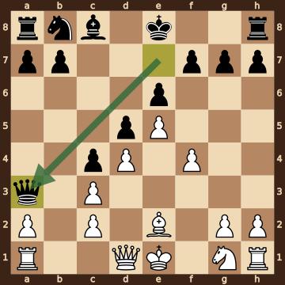
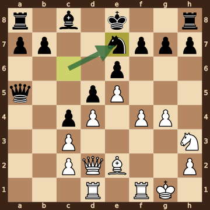
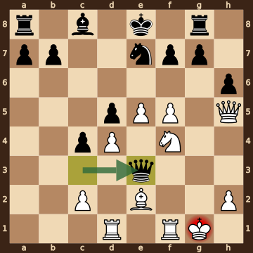
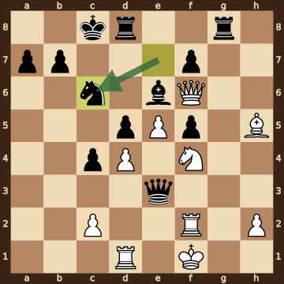
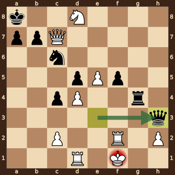
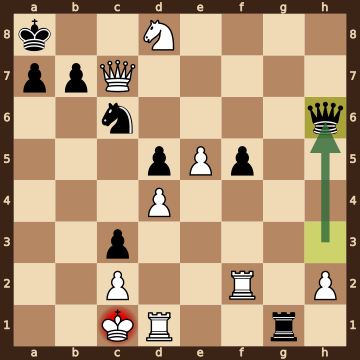
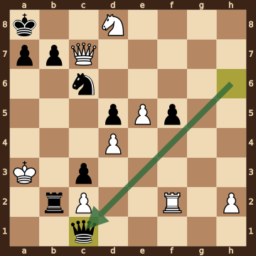
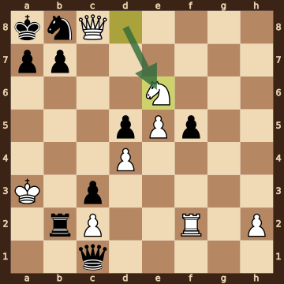
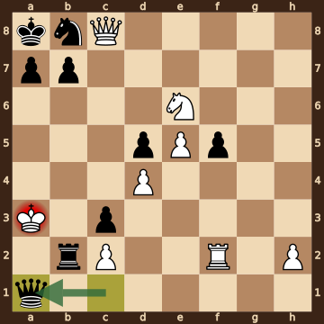

Bhoir Paras Dilip (2414) – Ohanyan,Emin (2520) · Atyrau Chess Masters Open, round 2.12, 2026.10.13. The game ends in checkmate on move 42. [Download the PGN](game.pgn)

Read each step's moves, play them **in your head** (no board!), then click the cards to check yourself. Board pictures only appear inside the answers — and once, after step 2.



### Step 1 · Moves 1–5




| | Pawns (moved ones in **bold**) | Count |
|---|---|---|
| White | a2 b2 c2 **d4** **e5** f2 g2 h2 | 8 |
| Black | a7 b7 c7 **d5** **e6** f7 g7 h7 | 8 |

In the center (c- to f-files, ranks 3–6): White d4 e5; Black d5 e6.



**White:** bishop **g5**, knight **c3**.

**Black:** bishop **e7**, knight **e4**.


### Step 2 · Moves 6–10




| | Pawns (moved ones in **bold**) | Count |
|---|---|---|
| White | a2 c2 **c3** **d4** **e5** **f4** g2 h2 | 8 |
| Black | a7 b7 **c4** **d5** **e6** f7 g7 h7 | 8 |

In the center (c- to f-files, ranks 3–6): White c3 d4 e5 f4; Black c4 d5 e6.



**White:** bishop **e2**.

**Black:** queen **a3**.

Gone from the board: White has lost 1 bishop, 1 knight; Black has lost 1 bishop, 1 knight.



**White king: e1** — still on its starting square, not castled.

**Black king: e8** — still on its starting square, not castled.



**No file is fully open** — every file still has a pawn on it.

Half open for White (only a Black pawn on it): b-file.


**Check your picture** — the position after 10...Qa3:

### Step 3 · Moves 11–15




| | White | Black |
|---|---|---|
| Pawns | c2 c3 d4 e5 f4 g4 h2 | a7 b7 c4 d5 e6 f7 g7 h7 |
| Knights | h3 | e7 |
| Bishops | e2 | c8 |
| Rooks | d1 f1 | a8 h8 |
| Queen | d2 | a5 |
| King | g1 | e8 |




White's king is on **g1**.

Its own pieces close by: rook **f1**, bishop **e2**, knight **h3**, pawn **h2**.

Black pieces close by: none.

Squares next to the king that Black already hits: none.



**12...Qxa2** took a pawn on a2.


### Step 4 · Moves 16–20




| | White | Black |
|---|---|---|
| Pawns | c2 d4 e5 f5 h2 | a7 b7 c4 d5 f7 g7 h6 |
| Knights | f4 | e7 |
| Bishops | e2 | c8 |
| Rooks | d1 f1 | a8 g8 |
| Queen | h5 | e3 |
| King | g1 | e8 |




**Black is ahead by 2 points.**

| | Pieces | Points |
|---|---|---|
| White | Q, 2R, B, N, 5 pawns | 30 |
| Black | Q, 2R, B, N, 7 pawns | 32 |

(Pawn 1, knight 3, bishop 3, rook 5, queen 9.)



**White king: g1** — castled kingside.

**Black king: e8** — still on its starting square, not castled.


### Step 5 · Moves 21–25




| | White | Black |
|---|---|---|
| Pawns | c2 d4 e5 h2 | a7 b7 c4 d5 f5 f7 |
| Knights | f4 | c6 |
| Bishops | h5 | e6 |
| Rooks | d1 f2 | d8 g8 |
| Queen | f6 | e3 |
| King | f1 | c8 |




**Open files** (no pawns at all): g-file.

Half open for White (only a Black pawn on it): a-file, b-file, f-file.

Half open for Black (only a White pawn on it): e-file, h-file.

Already on an open file: Black rook g8.



**White:** none — every piece has moved. Pawns still at home: c2 h2.

**Black:** none — every piece has moved. Pawns still at home: a7 b7 f7.


### Step 6 · Moves 26–30




| | White | Black |
|---|---|---|
| Pawns | c2 d4 e5 h2 | a7 b7 c4 d5 f5 |
| Knights | d8 | c6 |
| Bishops | — | — |
| Rooks | d1 f2 | g4 |
| Queen | c7 | h3 |
| King | f1 | a8 |




White's king is on **f1**.

Its own pieces close by: rook **d1**, rook **f2**, pawn **h2**.

Black pieces close by: queen **h3**.

Squares next to the king that Black already hits: g1 (rook g4); g2 (queen h3, rook g4).



**26.Bxf7** took a pawn on f7.

**26...Bxf7** took a bishop on f7.

**27.Qxf7** took a bishop on f7.

**30.Nxd8** took a rook on d8.


### Step 7 · Moves 31–35




| | White | Black |
|---|---|---|
| Pawns | c2 d4 e5 h2 | a7 b7 c3 d5 f5 |
| Knights | d8 | c6 |
| Bishops | — | — |
| Rooks | d1 f2 | g1 |
| Queen | c7 | h6 |
| King | c1 | a8 |




**White is ahead by 4 points.**

| | Pieces | Points |
|---|---|---|
| White | Q, 2R, N, 4 pawns | 26 |
| Black | Q, R, N, 5 pawns | 22 |

(Pawn 1, knight 3, bishop 3, rook 5, queen 9.)



**White king: c1** — castled kingside.

**Black king: a8** — castled queenside.


### Step 8 · Moves 36–40




| | White | Black |
|---|---|---|
| Pawns | c2 d4 e5 h2 | a7 b7 c3 d5 f5 |
| Knights | d8 | c6 |
| Bishops | — | — |
| Rooks | f2 | b2 |
| Queen | c7 | c1 |
| King | a3 | a8 |




**Open files** (no pawns at all): g-file.

Half open for White (only a Black pawn on it): a-file, b-file, f-file.

Half open for Black (only a White pawn on it): e-file, h-file.



**White:** none — every piece has moved. Pawns still at home: c2 h2.

**Black:** none — every piece has moved. Pawns still at home: a7 b7.


### Step 9 · Moves 41–42




| | White | Black |
|---|---|---|
| Pawns | c2 d4 e5 h2 | a7 b7 c3 d5 f5 |
| Knights | e6 | b8 |
| Bishops | — | — |
| Rooks | f2 | b2 |
| Queen | c8 | c1 |
| King | a3 | a8 |




**Black is ahead by 1 point.**

| | Pieces | Points |
|---|---|---|
| White | Q, R, N, 4 pawns | 21 |
| Black | Q, R, N, 5 pawns | 22 |

(Pawn 1, knight 3, bishop 3, rook 5, queen 9.)



White's king is on **a3**.

Its own pieces close by: pawn **c2**.

Black pieces close by: queen **c1**, rook **b2**, pawn **c3**.

Squares next to the king that Black already hits: a2 (rook b2); b2 (queen c1, pawn c3); b3 (rook b2); b4 (rook b2).


### Final question




Check from the queen on a1.

The White king on a3 has no square to go to:

- **a2** — covered by the queen on a1 and the rook on b2
- **a4** — covered by the queen on a1
- **b2** — the Black rook stands there, protected by the queen on a1 and the pawn on c3
- **b3** — covered by the rook on b2
- **b4** — covered by the rook on b2

Nothing can take the queen. Nothing can step in between on a2.


