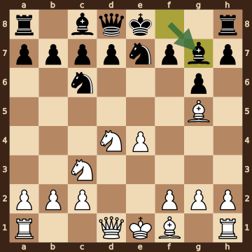
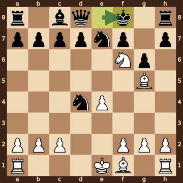
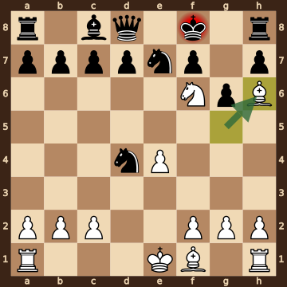

Benjamin Markovich Blumenfeld – NN · Moscow, 1903. The game ends in checkmate on move 10. [Download the PGN](game.pgn)

Read each step's moves, play them **in your head** (no board!), then click the cards to check yourself. Board pictures only appear inside the answers — and once, after step 2.



### Step 1 · Moves 1–3




| | Pawns (moved ones in **bold**) | Count |
|---|---|---|
| White | a2 b2 c2 **e4** f2 g2 h2 | 7 |
| Black | a7 b7 c7 **d4** d7 f7 g7 h7 | 8 |

In the center (c- to f-files, ranks 3–6): White e4; Black d4.



**White:** knight **f3**.

**Black:** knight **c6**.

Gone from the board: White has lost 1 pawn.


### Step 2 · Moves 4–6




| | Pawns (moved ones in **bold**) | Count |
|---|---|---|
| White | a2 b2 c2 **e4** f2 g2 h2 | 7 |
| Black | a7 b7 c7 d7 f7 **g6** h7 | 7 |

In the center (c- to f-files, ranks 3–6): White e4; Black none.



**White:** bishop **g5**, knight **c3**, knight **d4**.

**Black:** bishop **g7**, knight **c6**, knight **e7**.

Gone from the board: White has lost 1 pawn; Black has lost 1 pawn.



**White king: e1** — still on its starting square, not castled.

**Black king: e8** — still on its starting square, not castled.



**No file is fully open** — every file still has a pawn on it.

Half open for White (only a Black pawn on it): d-file.

Half open for Black (only a White pawn on it): e-file.


**Check your picture** — the position after 6...Bg7:

### Step 3 · Moves 7–9




| | White | Black |
|---|---|---|
| Pawns | a2 b2 c2 e4 f2 g2 h2 | a7 b7 c7 d7 f7 g6 h7 |
| Knights | f6 | d4 e7 |
| Bishops | f1 g5 | c8 |
| Rooks | a1 h1 | a8 h8 |
| Queen | — | d8 |
| King | e1 | f8 |




**Black is ahead by 9 points.**

| | Pieces | Points |
|---|---|---|
| White | 2R, 2B, N, 7 pawns | 26 |
| Black | Q, 2R, B, 2N, 7 pawns | 35 |

(Pawn 1, knight 3, bishop 3, rook 5, queen 9.)



Black's king is on **f8**.

Its own pieces close by: queen **d8**, rook **h8**, knight **e7**, pawn **d7**, pawn **f7**, pawn **g6**, pawn **h7**.

White pieces close by: knight **f6**.

Squares next to the king that White already hits: e8 (knight f6); g8 (knight f6).


### Final question




Check from the bishop on h6.

The Black king on f8 has no square to go to:

- **e7** — blocked by its own knight
- **e8** — covered by the knight on f6
- **f7** — blocked by its own pawn
- **g7** — covered by the bishop on h6
- **g8** — covered by the knight on f6

Nothing can take the bishop. Nothing can step in between on g7.


