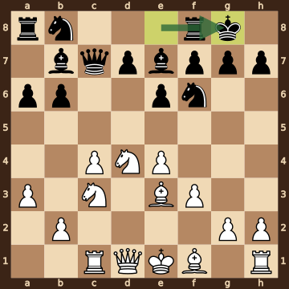
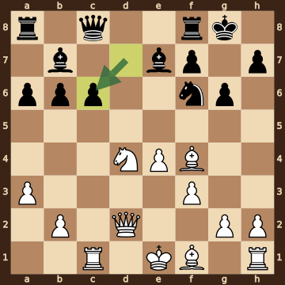
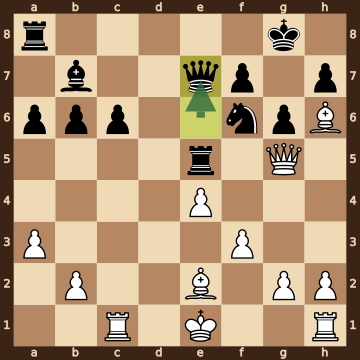
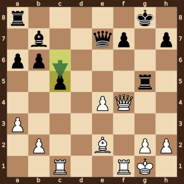
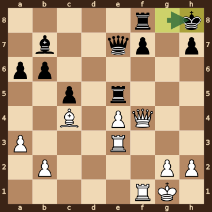
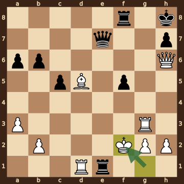
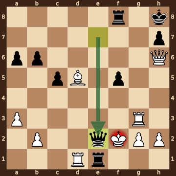

Bogdanov,Artyom (2455) – Acs,Peter (2554) · Spilimbergo GM 2026, round 7.4, 2026.10.13. The game ends in checkmate on move 35. [Download the PGN](game.pgn)

Read each step's moves, play them **in your head** (no board!), then click the cards to check yourself. Board pictures only appear inside the answers — and once, after step 2.



### Step 1 · Moves 1–5




| | Pawns (moved ones in **bold**) | Count |
|---|---|---|
| White | a2 b2 **c4** **e4** f2 g2 h2 | 7 |
| Black | **a6** b7 d7 **e6** f7 g7 h7 | 7 |

In the center (c- to f-files, ranks 3–6): White c4 e4; Black e6.



**White:** knight **d4**.

**Black:** knight **f6**.

Gone from the board: White has lost 1 pawn; Black has lost 1 pawn.


### Step 2 · Moves 6–10




| | Pawns (moved ones in **bold**) | Count |
|---|---|---|
| White | **a3** b2 **c4** **e4** **f3** g2 h2 | 7 |
| Black | **a6** **b6** d7 **e6** f7 g7 h7 | 7 |

In the center (c- to f-files, ranks 3–6): White c4 e4 f3; Black e6.



**White:** rook **c1**, bishop **e3**, knight **c3**, knight **d4**.

**Black:** king **g8**, queen **c7**, rook **f8**, bishop **b7**, bishop **e7**, knight **f6**.

Gone from the board: White has lost 1 pawn; Black has lost 1 pawn.



**White king: e1** — still on its starting square, not castled.

**Black king: g8** — castled kingside.



**No file is fully open** — every file still has a pawn on it.

Half open for White (only a Black pawn on it): d-file.

Half open for Black (only a White pawn on it): c-file.


**Check your picture** — the position after 10...O-O:

### Step 3 · Moves 11–15




| | White | Black |
|---|---|---|
| Pawns | a3 b2 e4 f3 g2 h2 | a6 b6 c6 f7 g6 h7 |
| Knights | d4 | f6 |
| Bishops | f1 f4 | b7 e7 |
| Rooks | c1 h1 | a8 f8 |
| Queen | d2 | c8 |
| King | e1 | g8 |




White's king is on **e1**.

Its own pieces close by: queen **d2**, rook **c1**, bishop **f1**, pawn **f3**, pawn **g2**.

Black pieces close by: none.

Squares next to the king that Black already hits: none.



**12...exd5** took a knight on d5.

**13.cxd5** took a pawn on d5.

**15.dxc6** took a knight on c6.

**15...dxc6** took a pawn on c6.


### Step 4 · Moves 16–20




| | White | Black |
|---|---|---|
| Pawns | a3 b2 e4 f3 g2 h2 | a6 b6 c6 f7 g6 h7 |
| Knights | — | f6 |
| Bishops | e2 h6 | b7 |
| Rooks | c1 h1 | a8 e5 |
| Queen | g5 | e7 |
| King | e1 | g8 |




**Material is equal.**

| | Pieces | Points |
|---|---|---|
| White | Q, 2R, 2B, 6 pawns | 31 |
| Black | Q, 2R, B, N, 6 pawns | 31 |

(Pawn 1, knight 3, bishop 3, rook 5, queen 9.)



**White king: e1** — still on its starting square, not castled.

**Black king: g8** — castled kingside.


### Step 5 · Moves 21–25




| | White | Black |
|---|---|---|
| Pawns | a3 b2 e4 g2 h2 | a6 b6 c5 f7 h7 |
| Knights | — | — |
| Bishops | e2 | b7 |
| Rooks | c1 f1 | a8 g5 |
| Queen | f4 | e7 |
| King | g1 | g8 |




**Open files** (no pawns at all): d-file.

Half open for White (only a Black pawn on it): c-file, f-file.

Half open for Black (only a White pawn on it): e-file, g-file.



**White:** none — every piece has moved. Pawns still at home: b2 g2 h2.

**Black:** rook **a8**. Pawns still at home: f7 h7.


### Step 6 · Moves 26–30




| | White | Black |
|---|---|---|
| Pawns | a3 b2 e4 g2 h2 | a6 b6 c5 f7 h7 |
| Knights | — | — |
| Bishops | c4 | b7 |
| Rooks | e3 f1 | e5 f8 |
| Queen | f4 | e7 |
| King | g1 | h8 |




White's king is on **g1**.

Its own pieces close by: rook **e3**, rook **f1**, pawn **g2**, pawn **h2**.

Black pieces close by: none.

Squares next to the king that Black already hits: none.



**White:** none — every piece has moved. Pawns still at home: b2 g2 h2.

**Black:** none — every piece has moved. Pawns still at home: f7 h7.


### Step 7 · Moves 31–35




| | White | Black |
|---|---|---|
| Pawns | a3 b2 g2 h2 | a6 b6 c5 f5 h7 |
| Knights | — | — |
| Bishops | d5 | — |
| Rooks | d1 g3 | e1 f8 |
| Queen | h6 | e7 |
| King | f2 | h8 |




**White is ahead by 2 points.**

| | Pieces | Points |
|---|---|---|
| White | Q, 2R, B, 4 pawns | 26 |
| Black | Q, 2R, 5 pawns | 24 |

(Pawn 1, knight 3, bishop 3, rook 5, queen 9.)



White's king is on **f2**.

Its own pieces close by: rook **d1**, rook **g3**, pawn **g2**, pawn **h2**.

Black pieces close by: rook **e1**.

Squares next to the king that Black already hits: e1 (queen e7); e2 (rook e1, queen e7); e3 (rook e1, queen e7); f1 (rook e1); g1 (rook e1).


### Final question




Check from the queen on e2.

The White king on f2 has no square to go to:

- **e1** — the Black rook stands there, protected by the queen on e2
- **e2** — the Black queen stands there, protected by the rook on e1
- **e3** — covered by the queen on e2
- **f1** — covered by the rook on e1 and the queen on e2
- **f3** — covered by the queen on e2
- **g1** — covered by the rook on e1
- **g2** — blocked by its own pawn
- **g3** — blocked by its own rook

The king can't take the queen — it is protected by the rook on e1.


