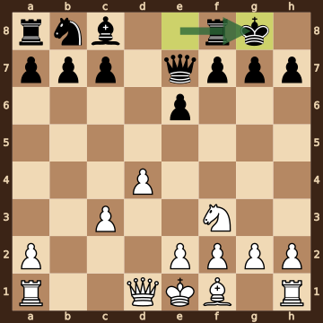
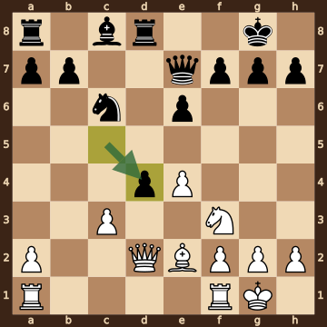
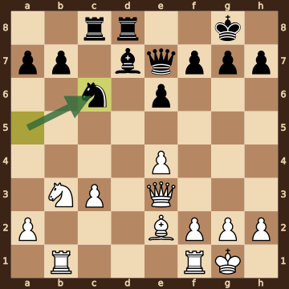
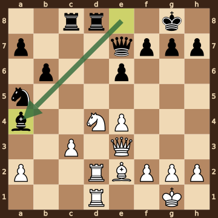
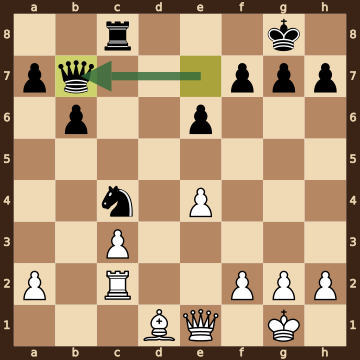
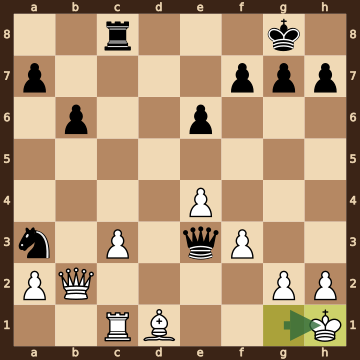
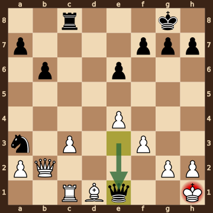

Botica,Viseslav (2105) – Singh,Siddharth (2425) · FIDE World U15 Open 2026, round 4.7, 2026.10.15. The game ends in checkmate on move 29. [Download the PGN](game.pgn)

Read each step's moves, play them **in your head** (no board!), then click the cards to check yourself. Board pictures only appear inside the answers — and once, after step 2.



### Step 1 · Moves 1–4




| | Pawns (moved ones in **bold**) | Count |
|---|---|---|
| White | a2 b2 **c4** **d4** e2 f2 g2 h2 | 8 |
| Black | a7 b7 c7 **d5** **e6** f7 g7 h7 | 8 |

In the center (c- to f-files, ranks 3–6): White c4 d4; Black d5 e6.



**White:** bishop **g5**, knight **c3**.

**Black:** bishop **e7**, knight **f6**.


### Step 2 · Moves 5–8




| | Pawns (moved ones in **bold**) | Count |
|---|---|---|
| White | a2 **c3** **d4** e2 f2 g2 h2 | 7 |
| Black | a7 b7 c7 **e6** f7 g7 h7 | 7 |

In the center (c- to f-files, ranks 3–6): White c3 d4; Black e6.



**White:** knight **f3**.

**Black:** king **g8**, queen **e7**, rook **f8**.

Gone from the board: White has lost 1 bishop, 1 knight, 1 pawn; Black has lost 1 bishop, 1 knight, 1 pawn.



**White king: e1** — still on its starting square, not castled.

**Black king: g8** — castled kingside.



**No file is fully open** — every file still has a pawn on it.

Half open for White (only a Black pawn on it): b-file.

Half open for Black (only a White pawn on it): d-file.


**Check your picture** — the position after 8...O-O:

### Step 3 · Moves 9–12




| | White | Black |
|---|---|---|
| Pawns | a2 c3 e4 f2 g2 h2 | a7 b7 d4 e6 f7 g7 h7 |
| Knights | f3 | c6 |
| Bishops | e2 | c8 |
| Rooks | a1 f1 | a8 d8 |
| Queen | d2 | e7 |
| King | g1 | g8 |




White's king is on **g1**.

Its own pieces close by: rook **f1**, bishop **e2**, knight **f3**, pawn **f2**, pawn **g2**, pawn **h2**.

Black pieces close by: none.

Squares next to the king that Black already hits: none.



**12...cxd4** took a pawn on d4.


### Step 4 · Moves 13–16




| | White | Black |
|---|---|---|
| Pawns | a2 c3 e4 f2 g2 h2 | a7 b7 e6 f7 g7 h7 |
| Knights | b3 | c6 |
| Bishops | e2 | d7 |
| Rooks | b1 f1 | c8 d8 |
| Queen | e3 | e7 |
| King | g1 | g8 |




**Material is equal.**

| | Pieces | Points |
|---|---|---|
| White | Q, 2R, B, N, 6 pawns | 31 |
| Black | Q, 2R, B, N, 6 pawns | 31 |

(Pawn 1, knight 3, bishop 3, rook 5, queen 9.)



**White king: g1** — castled kingside.

**Black king: g8** — castled kingside.


### Step 5 · Moves 17–20




| | White | Black |
|---|---|---|
| Pawns | a2 c3 e4 f2 g2 h2 | a7 b6 e6 f7 g7 h7 |
| Knights | d4 | a5 |
| Bishops | e2 | a4 |
| Rooks | d1 d2 | c8 d8 |
| Queen | e3 | e7 |
| King | g1 | g8 |




**Open files** (no pawns at all): d-file.

Half open for White (only a Black pawn on it): b-file.

Half open for Black (only a White pawn on it): c-file.

Already on an open file: White rook d1, White rook d2, Black rook d8.



**White:** none — every piece has moved. Pawns still at home: a2 f2 g2 h2.

**Black:** none — every piece has moved. Pawns still at home: a7 f7 g7 h7.


### Step 6 · Moves 21–24




| | White | Black |
|---|---|---|
| Pawns | a2 c3 e4 f2 g2 h2 | a7 b6 e6 f7 g7 h7 |
| Knights | — | c4 |
| Bishops | d1 | — |
| Rooks | c2 | c8 |
| Queen | e1 | b7 |
| King | g1 | g8 |




White's king is on **g1**.

Its own pieces close by: queen **e1**, pawn **f2**, pawn **g2**, pawn **h2**.

Black pieces close by: none.

Squares next to the king that Black already hits: none.



**21...Bxc2** took a knight on c2.

**22.Rxc2** took a bishop on c2.

**22...Rxd1+** took a rook on d1.

**23.Bxd1** took a rook on d1.


### Step 7 · Moves 25–29




| | White | Black |
|---|---|---|
| Pawns | a2 c3 e4 f3 g2 h2 | a7 b6 e6 f7 g7 h7 |
| Knights | — | a3 |
| Bishops | d1 | — |
| Rooks | c1 | c8 |
| Queen | b2 | e3 |
| King | h1 | g8 |




**Material is equal.**

| | Pieces | Points |
|---|---|---|
| White | Q, R, B, 6 pawns | 23 |
| Black | Q, R, N, 6 pawns | 23 |

(Pawn 1, knight 3, bishop 3, rook 5, queen 9.)



White's king is on **h1**.

Its own pieces close by: pawn **f3**, pawn **g2**, pawn **h2**.

Black pieces close by: none.

Squares next to the king that Black already hits: g1 (queen e3).


### Final question




Check from the queen on e1.

The White king on h1 has no square to go to:

- **g1** — covered by the queen on e1
- **g2** — blocked by its own pawn
- **h2** — blocked by its own pawn

Nothing can take the queen. Nothing can step in between on f1 g1.


