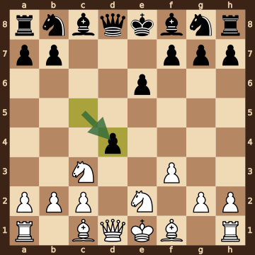
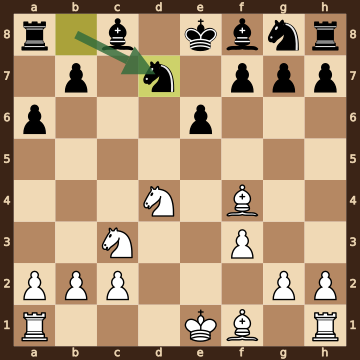
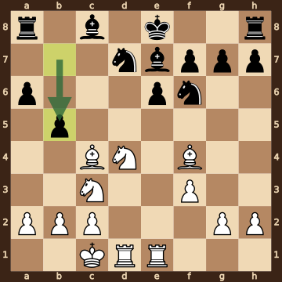
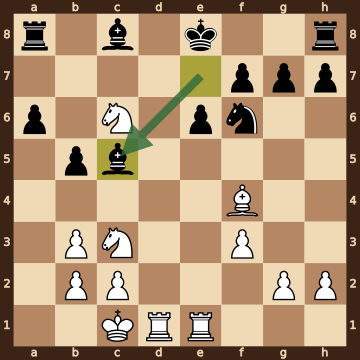
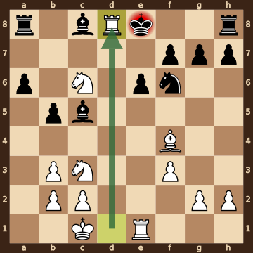

Bozorov,Javohir (2208) – Cardenas Lima Vincent Matias (1969) · Titled Tue 13th Oct 2026, round 1, 2026.10.13. The game ends in checkmate on move 16. [Download the PGN](game.pgn)

Read each step's moves, play them **in your head** (no board!), then click the cards to check yourself. Board pictures only appear inside the answers — and once, after step 2.



### Step 1 · Moves 1–3




| | Pawns (moved ones in **bold**) | Count |
|---|---|---|
| White | a2 b2 c2 d2 **e4** **f3** g2 h2 | 8 |
| Black | a7 b7 **c5** **d5** **e6** f7 g7 h7 | 8 |

In the center (c- to f-files, ranks 3–6): White e4 f3; Black c5 d5 e6.



**White:** knight **e2**.

**Black:** nothing yet.


### Step 2 · Moves 4–6




| | Pawns (moved ones in **bold**) | Count |
|---|---|---|
| White | a2 b2 c2 **f3** g2 h2 | 6 |
| Black | a7 b7 **d4** **e6** f7 g7 h7 | 7 |

In the center (c- to f-files, ranks 3–6): White f3; Black d4 e6.



**White:** knight **c3**, knight **e2**.

**Black:** queen **d8**.

Gone from the board: White has lost 2 pawns; Black has lost 1 pawn.



**White king: e1** — still on its starting square, not castled.

**Black king: e8** — still on its starting square, not castled.



**No file is fully open** — every file still has a pawn on it.

Half open for White (only a Black pawn on it): d-file, e-file.

Half open for Black (only a White pawn on it): c-file.


**Check your picture** — the position after 6...cxd4:

### Step 3 · Moves 7–9




| | White | Black |
|---|---|---|
| Pawns | a2 b2 c2 f3 g2 h2 | a6 b7 e6 f7 g7 h7 |
| Knights | c3 d4 | d7 g8 |
| Bishops | f1 f4 | c8 f8 |
| Rooks | a1 h1 | a8 h8 |
| Queen | — | — |
| King | e1 | e8 |




Black's king is on **e8**.

Its own pieces close by: bishop **c8**, bishop **f8**, knight **d7**, knight **g8**, pawn **e6**, pawn **f7**, pawn **g7**.

White pieces close by: none.

Squares next to the king that White already hits: none.



**7.Qxd4** took a pawn on d4.

**7...Qxd4** took a queen on d4.

**8.Nxd4** took a queen on d4.


### Step 4 · Moves 10–12




| | White | Black |
|---|---|---|
| Pawns | a2 b2 c2 f3 g2 h2 | a6 b5 e6 f7 g7 h7 |
| Knights | c3 d4 | d7 f6 |
| Bishops | c4 f4 | c8 e7 |
| Rooks | d1 e1 | a8 h8 |
| Queen | — | — |
| King | c1 | e8 |




**Material is equal.**

| | Pieces | Points |
|---|---|---|
| White | 2R, 2B, 2N, 6 pawns | 28 |
| Black | 2R, 2B, 2N, 6 pawns | 28 |

(Pawn 1, knight 3, bishop 3, rook 5, queen 9.)



**White king: c1** — castled queenside.

**Black king: e8** — still on its starting square, not castled.


### Step 5 · Moves 13–15




| | White | Black |
|---|---|---|
| Pawns | b2 b3 c2 f3 g2 h2 | a6 b5 e6 f7 g7 h7 |
| Knights | c3 c6 | f6 |
| Bishops | f4 | c5 c8 |
| Rooks | d1 e1 | a8 h8 |
| Queen | — | — |
| King | c1 | e8 |




**Material is equal.**

| | Pieces | Points |
|---|---|---|
| White | 2R, B, 2N, 6 pawns | 25 |
| Black | 2R, 2B, N, 6 pawns | 25 |

(Pawn 1, knight 3, bishop 3, rook 5, queen 9.)



Black's king is on **e8**.

Its own pieces close by: bishop **c8**, knight **f6**, pawn **e6**, pawn **f7**, pawn **g7**.

White pieces close by: knight **c6**.

Squares next to the king that White already hits: d7 (rook d1); d8 (rook d1, knight c6); e7 (knight c6).


### Final question




Check from the rook on d8.

The Black king on e8 has no square to go to:

- **d7** — covered by the rook on d8
- **d8** — the White rook stands there, protected by the knight on c6
- **e7** — covered by the knight on c6
- **f7** — blocked by its own pawn
- **f8** — covered by the rook on d8

The king can't take the rook — it is protected by the knight on c6.


