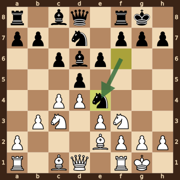
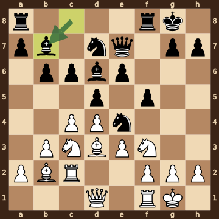
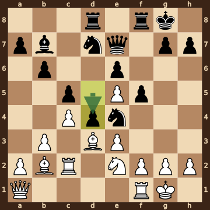
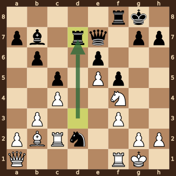
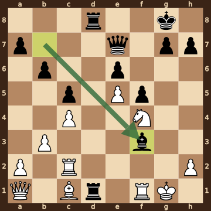
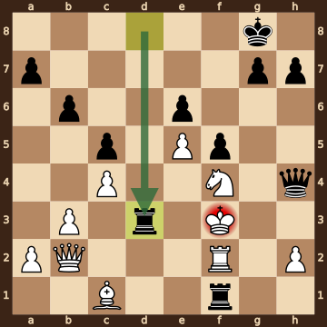
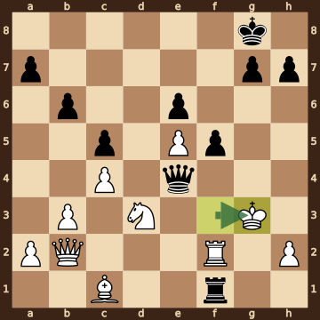
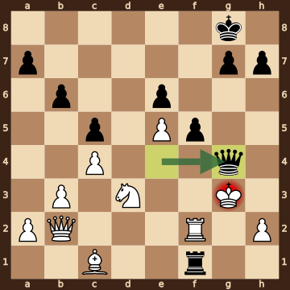

Bujnoch,R (2259) – Gurel,Ediz (2642) · 41st ECC Open 2026, round 3.1, 2026.10.19. The game ends in checkmate on move 30. [Download the PGN](game.pgn)

Read each step's moves, play them **in your head** (no board!), then click the cards to check yourself. Board pictures only appear inside the answers — and once, after step 2.



### Step 1 · Moves 1–4




| | Pawns (moved ones in **bold**) | Count |
|---|---|---|
| White | a2 b2 **c4** **d4** e2 f2 g2 h2 | 8 |
| Black | a7 b7 **c6** **d5** **e6** f7 g7 h7 | 8 |

In the center (c- to f-files, ranks 3–6): White c4 d4; Black c6 d5 e6.



**White:** knight **c3**, knight **f3**.

**Black:** knight **f6**.


### Step 2 · Moves 5–8




| | Pawns (moved ones in **bold**) | Count |
|---|---|---|
| White | a2 **b3** **c4** **d4** **e3** f2 g2 h2 | 8 |
| Black | a7 b7 **c6** **d5** **e6** f7 g7 h7 | 8 |

In the center (c- to f-files, ranks 3–6): White c4 d4 e3; Black c6 d5 e6.



**White:** king **g1**, rook **f1**, bishop **e2**, knight **c3**, knight **f3**.

**Black:** king **g8**, rook **f8**, bishop **d6**, knight **d7**, knight **e4**.



**White king: g1** — castled kingside.

**Black king: g8** — castled kingside.



**No file is fully open** — every file still has a pawn on it.


**Check your picture** — the position after 8...Ne4:

### Step 3 · Moves 9–12




| | White | Black |
|---|---|---|
| Pawns | a2 b3 c4 d4 e3 f2 g2 h2 | a7 b6 c6 d5 e6 f5 g7 h7 |
| Knights | c3 f3 | d7 e4 |
| Bishops | b2 d3 | b7 d6 |
| Rooks | c2 f1 | a8 f8 |
| Queen | d1 | e7 |
| King | g1 | g8 |




White's king is on **g1**.

Its own pieces close by: rook **f1**, knight **f3**, pawn **e3**, pawn **f2**, pawn **g2**, pawn **h2**.

Black pieces close by: none.

Squares next to the king that Black already hits: f2 (knight e4); h2 (bishop d6).



**White:** queen **d1**. Pawns still at home: a2 f2 g2 h2.

**Black:** rook **a8**. Pawns still at home: a7 g7 h7.


### Step 4 · Moves 13–16




| | White | Black |
|---|---|---|
| Pawns | a2 b3 c4 e3 e5 f2 g2 h2 | a7 b6 c5 d4 e6 f5 g7 h7 |
| Knights | e2 | d7 e4 |
| Bishops | b2 d3 | b7 |
| Rooks | c2 f1 | d8 f8 |
| Queen | a1 | e7 |
| King | g1 | g8 |




**Material is equal.**

| | Pieces | Points |
|---|---|---|
| White | Q, 2R, 2B, N, 8 pawns | 36 |
| Black | Q, 2R, B, 2N, 8 pawns | 36 |

(Pawn 1, knight 3, bishop 3, rook 5, queen 9.)



**White king: g1** — castled kingside.

**Black king: g8** — castled kingside.


### Step 5 · Moves 17–20




| | White | Black |
|---|---|---|
| Pawns | a2 b3 c4 e5 f3 g2 h2 | a7 b6 c5 e6 f5 g7 h7 |
| Knights | f4 | d2 |
| Bishops | b2 | b7 |
| Rooks | c2 f1 | d7 f8 |
| Queen | a1 | e7 |
| King | g1 | g8 |




**Open files** (no pawns at all): d-file.

Already on an open file: Black rook d7.



**White:** none — every piece has moved. Pawns still at home: a2 g2 h2.

**Black:** none — every piece has moved. Pawns still at home: a7 g7 h7.


### Step 6 · Moves 21–24




| | White | Black |
|---|---|---|
| Pawns | a2 b3 c4 e5 h2 | a7 b6 c5 e6 f5 g7 h7 |
| Knights | f4 | — |
| Bishops | c1 | f3 |
| Rooks | c2 f1 | d1 d8 |
| Queen | a1 | e7 |
| King | g1 | g8 |




White's king is on **g1**.

Its own pieces close by: rook **f1**, pawn **h2**.

Black pieces close by: bishop **f3**.

Squares next to the king that Black already hits: f1 (rook d1); g2 (bishop f3); h1 (bishop f3).



**22...Nxf3+** took a pawn on f3.

**23.gxf3** took a knight on f3.

**24...Bxf3** took a pawn on f3.


### Step 7 · Moves 25–28




| | White | Black |
|---|---|---|
| Pawns | a2 b3 c4 e5 h2 | a7 b6 c5 e6 f5 g7 h7 |
| Knights | f4 | — |
| Bishops | c1 | — |
| Rooks | f2 | d3 f1 |
| Queen | b2 | h4 |
| King | f3 | g8 |




**Black is ahead by 1 point.**

| | Pieces | Points |
|---|---|---|
| White | Q, R, B, N, 5 pawns | 25 |
| Black | Q, 2R, 7 pawns | 26 |

(Pawn 1, knight 3, bishop 3, rook 5, queen 9.)



**White king: f3** — castled kingside.

**Black king: g8** — castled kingside.


### Step 8 · Moves 29–30




| | White | Black |
|---|---|---|
| Pawns | a2 b3 c4 e5 h2 | a7 b6 c5 e6 f5 g7 h7 |
| Knights | d3 | — |
| Bishops | c1 | — |
| Rooks | f2 | f1 |
| Queen | b2 | e4 |
| King | g3 | g8 |




**White is ahead by 4 points.**

| | Pieces | Points |
|---|---|---|
| White | Q, R, B, N, 5 pawns | 25 |
| Black | Q, R, 7 pawns | 21 |

(Pawn 1, knight 3, bishop 3, rook 5, queen 9.)



White's king is on **g3**.

Its own pieces close by: rook **f2**, pawn **e5**, pawn **h2**.

Black pieces close by: queen **e4**, rook **f1**, pawn **f5**.

Squares next to the king that Black already hits: f2 (rook f1); f3 (queen e4); f4 (queen e4); g2 (queen e4); g4 (queen e4, pawn f5); h4 (queen e4).


### Final question




Check from the queen on g4.

The White king on g3 has no square to go to:

- **f2** — blocked by its own rook
- **f3** — covered by the queen on g4
- **f4** — covered by the queen on g4
- **g2** — covered by the queen on g4
- **g4** — the Black queen stands there, protected by the pawn on f5
- **h2** — blocked by its own pawn
- **h3** — covered by the queen on g4
- **h4** — covered by the queen on g4

The king can't take the queen — it is protected by the pawn on f5.


