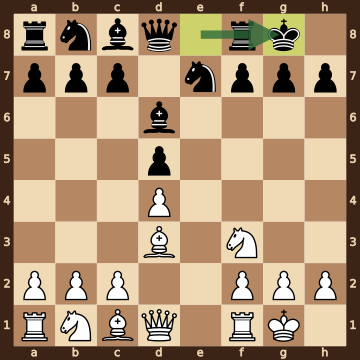
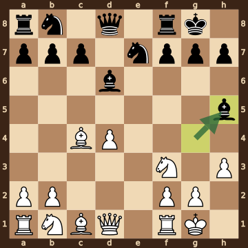
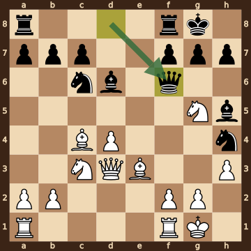
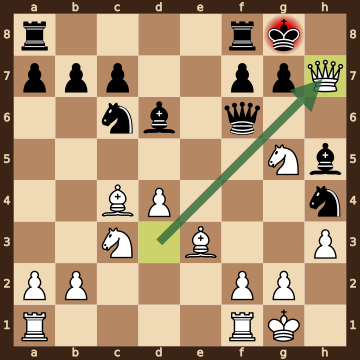

Dushatov,Timur (2146) – Cardozo,C (2067) · Titled Tue 13th Oct 2026, round 4, 2026.10.13. The game ends in checkmate on move 14. [Download the PGN](game.pgn)

Read each step's moves, play them **in your head** (no board!), then click the cards to check yourself. Board pictures only appear inside the answers — and once, after step 2.



### Step 1 · Moves 1–3




| | Pawns (moved ones in **bold**) | Count |
|---|---|---|
| White | a2 b2 c2 **d4** f2 g2 h2 | 7 |
| Black | a7 b7 c7 **d5** f7 g7 h7 | 7 |

In the center (c- to f-files, ranks 3–6): White d4; Black d5.



**White:** nothing yet.

**Black:** nothing yet.

Gone from the board: White has lost 1 pawn; Black has lost 1 pawn.


### Step 2 · Moves 4–6




| | Pawns (moved ones in **bold**) | Count |
|---|---|---|
| White | a2 b2 c2 **d4** f2 g2 h2 | 7 |
| Black | a7 b7 c7 **d5** f7 g7 h7 | 7 |

In the center (c- to f-files, ranks 3–6): White d4; Black d5.



**White:** king **g1**, rook **f1**, bishop **d3**, knight **f3**.

**Black:** king **g8**, rook **f8**, bishop **d6**, knight **e7**.

Gone from the board: White has lost 1 pawn; Black has lost 1 pawn.



**White king: g1** — castled kingside.

**Black king: g8** — castled kingside.



**Open files** (no pawns at all): e-file.


**Check your picture** — the position after 6...O-O:

### Step 3 · Moves 7–9




| | White | Black |
|---|---|---|
| Pawns | a2 b2 d4 f2 g2 h3 | a7 b7 c7 f7 g7 h7 |
| Knights | b1 f3 | b8 e7 |
| Bishops | c1 c4 | d6 h5 |
| Rooks | a1 f1 | a8 f8 |
| Queen | d1 | d8 |
| King | g1 | g8 |




Black's king is on **g8**.

Its own pieces close by: rook **f8**, knight **e7**, pawn **f7**, pawn **g7**, pawn **h7**.

White pieces close by: none.

Squares next to the king that White already hits: f7 (bishop c4).



**7...dxc4** took a pawn on c4.

**8.Bxc4** took a pawn on c4.


### Step 4 · Moves 10–13




| | White | Black |
|---|---|---|
| Pawns | a2 b2 d4 f2 g2 h3 | a7 b7 c7 f7 g7 h7 |
| Knights | c3 g5 | c6 h4 |
| Bishops | c4 e3 | d6 h5 |
| Rooks | a1 f1 | a8 f8 |
| Queen | d3 | f6 |
| King | g1 | g8 |




**Material is equal.**

| | Pieces | Points |
|---|---|---|
| White | Q, 2R, 2B, 2N, 6 pawns | 37 |
| Black | Q, 2R, 2B, 2N, 6 pawns | 37 |

(Pawn 1, knight 3, bishop 3, rook 5, queen 9.)



Black's king is on **g8**.

Its own pieces close by: queen **f6**, rook **f8**, pawn **f7**, pawn **g7**, pawn **h7**.

White pieces close by: none.

Squares next to the king that White already hits: f7 (bishop c4, knight g5); h7 (queen d3, knight g5).


### Final question




Check from the queen on h7.

The Black king on g8 has no square to go to:

- **f7** — blocked by its own pawn
- **f8** — blocked by its own rook
- **g7** — blocked by its own pawn
- **h7** — the White queen stands there, protected by the knight on g5
- **h8** — covered by the queen on h7

The king can't take the queen — it is protected by the knight on g5.


