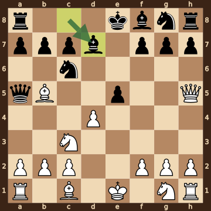
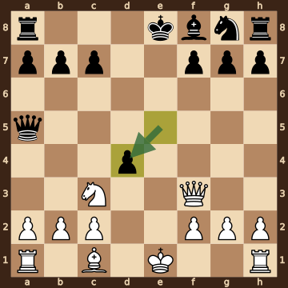
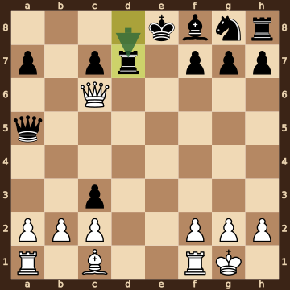
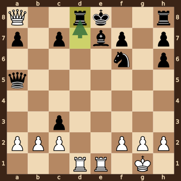
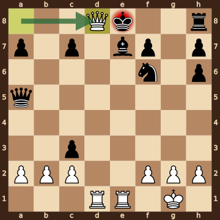

Firouzja,Alireza (2757) – Arslanov,S (2410) · Titled Tue 13th Oct 2026, round 2, 2026.10.13. The game ends in checkmate on move 17. [Download the PGN](game.pgn)

Read each step's moves, play them **in your head** (no board!), then click the cards to check yourself. Board pictures only appear inside the answers — and once, after step 2.



### Step 1 · Moves 1–3




| | Pawns (moved ones in **bold**) | Count |
|---|---|---|
| White | a2 b2 c2 d2 f2 g2 h2 | 7 |
| Black | a7 b7 c7 e7 f7 g7 h7 | 7 |

In the center (c- to f-files, ranks 3–6): White none; Black none.



**White:** knight **c3**.

**Black:** queen **a5**.

Gone from the board: White has lost 1 pawn; Black has lost 1 pawn.


### Step 2 · Moves 4–6




| | Pawns (moved ones in **bold**) | Count |
|---|---|---|
| White | a2 b2 c2 **d4** f2 g2 h2 | 7 |
| Black | a7 b7 c7 **e5** f7 g7 h7 | 7 |

In the center (c- to f-files, ranks 3–6): White d4; Black e5.



**White:** queen **h5**, bishop **b5**, knight **c3**.

**Black:** queen **a5**, bishop **d7**, knight **c6**.

Gone from the board: White has lost 1 pawn; Black has lost 1 pawn.



**White king: e1** — still on its starting square, not castled.

**Black king: e8** — still on its starting square, not castled.



**No file is fully open** — every file still has a pawn on it.

Half open for White (only a Black pawn on it): e-file.

Half open for Black (only a White pawn on it): d-file.


**Check your picture** — the position after 6...Bd7:

### Step 3 · Moves 7–9




| | White | Black |
|---|---|---|
| Pawns | a2 b2 c2 f2 g2 h2 | a7 b7 c7 d4 f7 g7 h7 |
| Knights | c3 | g8 |
| Bishops | c1 | f8 |
| Rooks | a1 h1 | a8 h8 |
| Queen | f3 | a5 |
| King | e1 | e8 |




Black's king is on **e8**.

Its own pieces close by: bishop **f8**, knight **g8**, pawn **c7**, pawn **f7**, pawn **g7**.

White pieces close by: none.

Squares next to the king that White already hits: f7 (queen f3).



**7.Bxc6** took a knight on c6.

**7...Bxc6** took a bishop on c6.

**8...Bxf3** took a knight on f3.

**9.Qxf3** took a bishop on f3.

**9...exd4** took a pawn on d4.


### Step 4 · Moves 10–12




| | White | Black |
|---|---|---|
| Pawns | a2 b2 c2 f2 g2 h2 | a7 c3 c7 f7 g7 h7 |
| Knights | — | g8 |
| Bishops | c1 | f8 |
| Rooks | a1 f1 | d7 h8 |
| Queen | c6 | a5 |
| King | g1 | e8 |




**Black is ahead by 3 points.**

| | Pieces | Points |
|---|---|---|
| White | Q, 2R, B, 6 pawns | 28 |
| Black | Q, 2R, B, N, 6 pawns | 31 |

(Pawn 1, knight 3, bishop 3, rook 5, queen 9.)



**White king: g1** — castled kingside.

**Black king: e8** — still on its starting square, not castled.


### Step 5 · Moves 13–16




| | White | Black |
|---|---|---|
| Pawns | a2 b2 c2 f2 g2 h2 | a7 c3 c7 f7 h6 h7 |
| Knights | — | f6 |
| Bishops | — | e7 |
| Rooks | d1 e1 | d8 h8 |
| Queen | a8 | a5 |
| King | g1 | e8 |




**Black is ahead by 6 points.**

| | Pieces | Points |
|---|---|---|
| White | Q, 2R, 6 pawns | 25 |
| Black | Q, 2R, B, N, 6 pawns | 31 |

(Pawn 1, knight 3, bishop 3, rook 5, queen 9.)



Black's king is on **e8**.

Its own pieces close by: rook **d8**, bishop **e7**, knight **f6**, pawn **c7**, pawn **f7**.

White pieces close by: none.

Squares next to the king that White already hits: d7 (rook d1); d8 (rook d1, queen a8); e7 (rook e1).


### Final question




Check from the queen on d8.

The Black king on e8 has no square to go to:

- **d7** — covered by the rook on d1 and the queen on d8
- **d8** — the White queen stands there, protected by the rook on d1
- **e7** — blocked by its own bishop
- **f7** — blocked by its own pawn
- **f8** — covered by the queen on d8

The king can't take the queen — it is protected by the rook on d1. The bishop on e7 could take it, but it is **pinned** to its king by the rook on e1.


