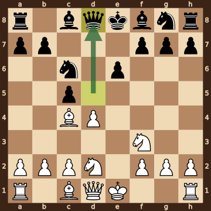
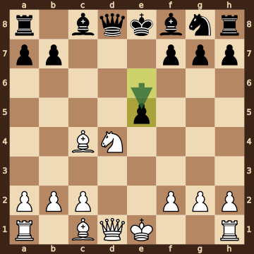
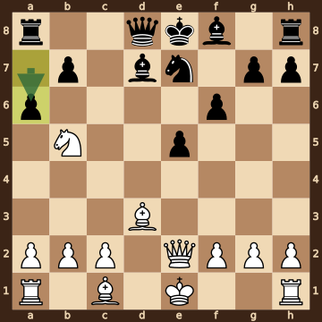
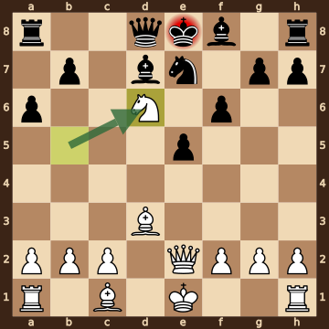

Josso,Benjamin (1861) – O'Neill,Stephen G (1652) · 36th NATO Chess 2026, round 2.54, 2026.10.13. The game ends in checkmate on move 14. [Download the PGN](game.pgn)

Read each step's moves, play them **in your head** (no board!), then click the cards to check yourself. Board pictures only appear inside the answers — and once, after step 2.



### Step 1 · Moves 1–3




| | Pawns (moved ones in **bold**) | Count |
|---|---|---|
| White | a2 b2 c2 **d4** **e4** f2 g2 h2 | 8 |
| Black | a7 b7 **c5** **d5** **e6** f7 g7 h7 | 8 |

In the center (c- to f-files, ranks 3–6): White d4 e4; Black c5 d5 e6.



**White:** knight **d2**.

**Black:** nothing yet.


### Step 2 · Moves 4–6




| | Pawns (moved ones in **bold**) | Count |
|---|---|---|
| White | a2 b2 c2 **d4** f2 g2 h2 | 7 |
| Black | a7 b7 **c5** **e6** f7 g7 h7 | 7 |

In the center (c- to f-files, ranks 3–6): White d4; Black c5 e6.



**White:** bishop **c4**, knight **d2**, knight **f3**.

**Black:** queen **d8**, knight **c6**.

Gone from the board: White has lost 1 pawn; Black has lost 1 pawn.



**White king: e1** — still on its starting square, not castled.

**Black king: e8** — still on its starting square, not castled.



**No file is fully open** — every file still has a pawn on it.

Half open for White (only a Black pawn on it): e-file.

Half open for Black (only a White pawn on it): d-file.


**Check your picture** — the position after 6...Qd8:

### Step 3 · Moves 7–9




| | White | Black |
|---|---|---|
| Pawns | a2 b2 c2 f2 g2 h2 | a7 b7 e5 f7 g7 h7 |
| Knights | d4 | g8 |
| Bishops | c1 c4 | c8 f8 |
| Rooks | a1 h1 | a8 h8 |
| Queen | d1 | d8 |
| King | e1 | e8 |




Black's king is on **e8**.

Its own pieces close by: queen **d8**, bishop **c8**, bishop **f8**, knight **g8**, pawn **f7**, pawn **g7**.

White pieces close by: none.

Squares next to the king that White already hits: f7 (bishop c4).



**7...cxd4** took a pawn on d4.

**8.Nbxd4** took a pawn on d4.

**8...Nxd4** took a knight on d4.

**9.Nxd4** took a knight on d4.


### Step 4 · Moves 10–13




| | White | Black |
|---|---|---|
| Pawns | a2 b2 c2 f2 g2 h2 | a6 b7 e5 f6 g7 h7 |
| Knights | b5 | e7 |
| Bishops | c1 d3 | d7 f8 |
| Rooks | a1 h1 | a8 h8 |
| Queen | e2 | d8 |
| King | e1 | e8 |




**Material is equal.**

| | Pieces | Points |
|---|---|---|
| White | Q, 2R, 2B, N, 6 pawns | 34 |
| Black | Q, 2R, 2B, N, 6 pawns | 34 |

(Pawn 1, knight 3, bishop 3, rook 5, queen 9.)



Black's king is on **e8**.

Its own pieces close by: queen **d8**, bishop **d7**, bishop **f8**, knight **e7**, pawn **f6**, pawn **g7**.

White pieces close by: none.

Squares next to the king that White already hits: none.


### Final question




Check from the knight on d6.

The Black king on e8 has no square to go to:

- **d7** — blocked by its own bishop
- **d8** — blocked by its own queen
- **e7** — blocked by its own knight
- **f7** — covered by the knight on d6
- **f8** — blocked by its own bishop

Nothing can take the knight.


