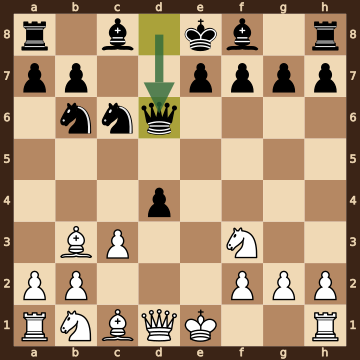
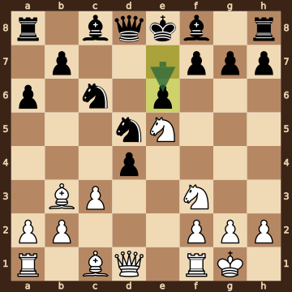
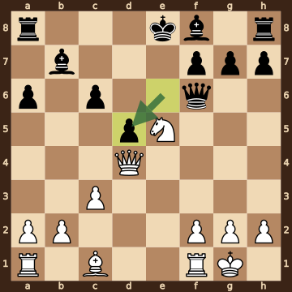
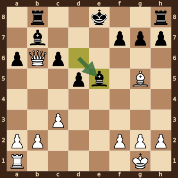
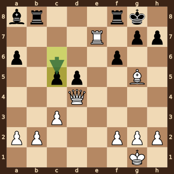
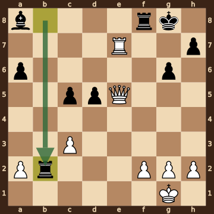
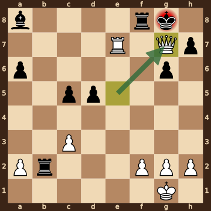

Loftgaard,Mikkel Vinh (2248) – Nielsen-Refs,Karl-Emil Elmer (2184) · Amager CA Centenary IM, round 7.2, 2026.10.16. The game ends in checkmate on move 28. [Download the PGN](game.pgn)

Read each step's moves, play them **in your head** (no board!), then click the cards to check yourself. Board pictures only appear inside the answers — and once, after step 2.



### Step 1 · Moves 1–4




| | Pawns (moved ones in **bold**) | Count |
|---|---|---|
| White | a2 b2 **c3** **e4** f2 g2 h2 | 7 |
| Black | a7 b7 **d4** d7 e7 f7 g7 h7 | 8 |

In the center (c- to f-files, ranks 3–6): White c3 e4; Black d4.



**White:** knight **f3**.

**Black:** knight **c6**, knight **f6**.

Gone from the board: White has lost 1 pawn.


### Step 2 · Moves 5–8




| | Pawns (moved ones in **bold**) | Count |
|---|---|---|
| White | a2 b2 **c3** f2 g2 h2 | 6 |
| Black | a7 b7 **d4** e7 f7 g7 h7 | 7 |

In the center (c- to f-files, ranks 3–6): White c3; Black d4.



**White:** bishop **b3**, knight **f3**.

**Black:** queen **d6**, knight **b6**, knight **c6**.

Gone from the board: White has lost 2 pawns; Black has lost 1 pawn.



**White king: e1** — still on its starting square, not castled.

**Black king: e8** — still on its starting square, not castled.



**No file is fully open** — every file still has a pawn on it.

Half open for White (only a Black pawn on it): d-file, e-file.

Half open for Black (only a White pawn on it): c-file.


**Check your picture** — the position after 8...Qxd6:

### Step 3 · Moves 9–12




| | White | Black |
|---|---|---|
| Pawns | a2 b2 c3 f2 g2 h2 | a6 b7 d4 e6 f7 g7 h7 |
| Knights | e5 f3 | c6 d5 |
| Bishops | b3 c1 | c8 f8 |
| Rooks | a1 f1 | a8 h8 |
| Queen | d1 | d8 |
| King | g1 | e8 |




Black's king is on **e8**.

Its own pieces close by: queen **d8**, bishop **c8**, bishop **f8**, knight **c6**, pawn **e6**, pawn **f7**, pawn **g7**.

White pieces close by: none.

Squares next to the king that White already hits: d7 (knight e5); f7 (knight e5).



**White:** queen **d1**, rook **a1**, bishop **c1**. Pawns still at home: a2 b2 f2 g2 h2.

**Black:** king **e8**, rook **a8**, rook **h8**, bishop **c8**, bishop **f8**. Pawns still at home: b7 f7 g7 h7.


### Step 4 · Moves 13–16




| | White | Black |
|---|---|---|
| Pawns | a2 b2 c3 f2 g2 h2 | a6 c6 d5 f7 g7 h7 |
| Knights | e5 | — |
| Bishops | c1 | b7 f8 |
| Rooks | a1 f1 | a8 h8 |
| Queen | d4 | f6 |
| King | g1 | e8 |




**Material is equal.**

| | Pieces | Points |
|---|---|---|
| White | Q, 2R, B, N, 6 pawns | 31 |
| Black | Q, 2R, 2B, 6 pawns | 31 |

(Pawn 1, knight 3, bishop 3, rook 5, queen 9.)



**White king: g1** — castled kingside.

**Black king: e8** — still on its starting square, not castled.


### Step 5 · Moves 17–20




| | White | Black |
|---|---|---|
| Pawns | a2 b2 c3 f2 g2 h2 | a6 c6 d5 f7 g7 h7 |
| Knights | — | — |
| Bishops | g5 | b7 e5 |
| Rooks | a1 | b8 h8 |
| Queen | b6 | — |
| King | g1 | e8 |




**Open files** (no pawns at all): e-file.

Half open for White (only a Black pawn on it): d-file.

Half open for Black (only a White pawn on it): b-file.



**White:** rook **a1**. Pawns still at home: a2 b2 f2 g2 h2.

**Black:** king **e8**, rook **h8**. Pawns still at home: f7 g7 h7.


### Step 6 · Moves 21–24




| | White | Black |
|---|---|---|
| Pawns | a2 b2 c3 f2 g2 h2 | a6 c5 d5 f6 g7 h7 |
| Knights | — | — |
| Bishops | g5 | a8 |
| Rooks | e7 | b8 f8 |
| Queen | d4 | — |
| King | g1 | g8 |




Black's king is on **g8**.

Its own pieces close by: rook **f8**, pawn **f6**, pawn **g7**, pawn **h7**.

White pieces close by: rook **e7**.

Squares next to the king that White already hits: f7 (rook e7); g7 (rook e7).



**22.Rxe5** took a bishop on e5.


### Step 7 · Moves 25–27




| | White | Black |
|---|---|---|
| Pawns | a2 c3 f2 g2 h2 | a6 c5 d5 g6 h7 |
| Knights | — | — |
| Bishops | — | a8 |
| Rooks | e7 | b2 f8 |
| Queen | e5 | — |
| King | g1 | g8 |




**White is ahead by 1 point.**

| | Pieces | Points |
|---|---|---|
| White | Q, R, 5 pawns | 19 |
| Black | 2R, B, 5 pawns | 18 |

(Pawn 1, knight 3, bishop 3, rook 5, queen 9.)



Black's king is on **g8**.

Its own pieces close by: rook **f8**, pawn **g6**, pawn **h7**.

White pieces close by: rook **e7**.

Squares next to the king that White already hits: f7 (rook e7); g7 (queen e5, rook e7); h7 (rook e7); h8 (queen e5).


### Final question




Check from the queen on g7.

The Black king on g8 has no square to go to:

- **f7** — covered by the rook on e7 and the queen on g7
- **f8** — blocked by its own rook
- **g7** — the White queen stands there, protected by the rook on e7
- **h7** — blocked by its own pawn
- **h8** — covered by the queen on g7

The king can't take the queen — it is protected by the rook on e7.


