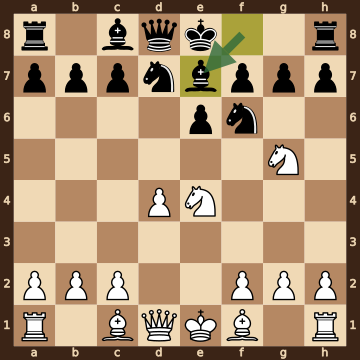
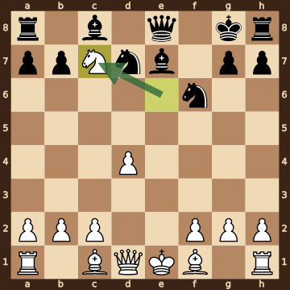
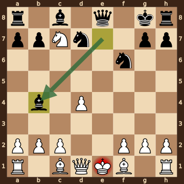

Heinrich Lohmann – Rudolf Teschner · German Championship Western Zone, 1950.05. The game ends in checkmate on move 10. [Download the PGN](game.pgn)

Read each step's moves, play them **in your head** (no board!), then click the cards to check yourself. Board pictures only appear inside the answers — and once, after step 2.



### Step 1 · Moves 1–3




| | Pawns (moved ones in **bold**) | Count |
|---|---|---|
| White | a2 b2 c2 **d4** f2 g2 h2 | 7 |
| Black | a7 b7 c7 **e4** **e6** f7 g7 h7 | 8 |

In the center (c- to f-files, ranks 3–6): White d4; Black e4 e6.



**White:** knight **c3**.

**Black:** nothing yet.

Gone from the board: White has lost 1 pawn.


### Step 2 · Moves 4–6




| | Pawns (moved ones in **bold**) | Count |
|---|---|---|
| White | a2 b2 c2 **d4** f2 g2 h2 | 7 |
| Black | a7 b7 c7 **e6** f7 g7 h7 | 7 |

In the center (c- to f-files, ranks 3–6): White d4; Black e6.



**White:** knight **e4**, knight **g5**.

**Black:** bishop **e7**, knight **d7**, knight **f6**.

Gone from the board: White has lost 1 pawn; Black has lost 1 pawn.



**White king: e1** — still on its starting square, not castled.

**Black king: e8** — still on its starting square, not castled.



**No file is fully open** — every file still has a pawn on it.

Half open for White (only a Black pawn on it): e-file.

Half open for Black (only a White pawn on it): d-file.


**Check your picture** — the position after 6...Be7:

### Step 3 · Moves 7–10




| | White | Black |
|---|---|---|
| Pawns | a2 b2 c2 d4 f2 g2 h2 | a7 b7 g7 h7 |
| Knights | c7 | d7 f6 |
| Bishops | c1 f1 | c8 e7 |
| Rooks | a1 h1 | a8 h8 |
| Queen | d1 | e8 |
| King | e1 | g8 |




**Material is equal.**

| | Pieces | Points |
|---|---|---|
| White | Q, 2R, 2B, N, 7 pawns | 35 |
| Black | Q, 2R, 2B, 2N, 4 pawns | 35 |

(Pawn 1, knight 3, bishop 3, rook 5, queen 9.)



White's king is on **e1**.

Its own pieces close by: queen **d1**, bishop **c1**, bishop **f1**, pawn **c2**, pawn **f2**, pawn **g2**.

Black pieces close by: none.

Squares next to the king that Black already hits: none.


### Final question




Check from the bishop on b4 and the queen on e8 — a **double check**, so the king must move.

The White king on e1 has no square to go to:

- **d1** — blocked by its own queen
- **d2** — covered by the bishop on b4
- **e2** — covered by the queen on e8
- **f1** — blocked by its own bishop
- **f2** — blocked by its own pawn


