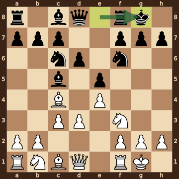
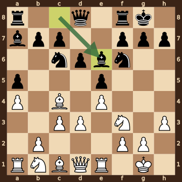
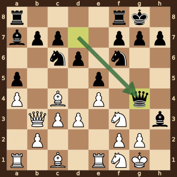
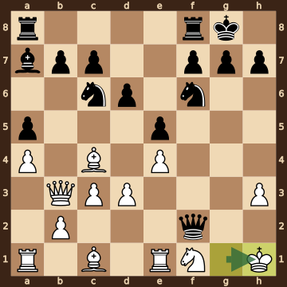
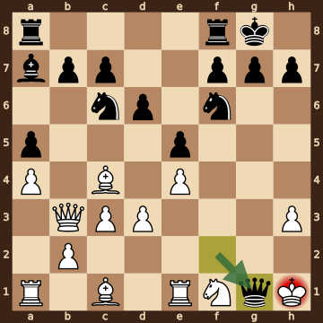

Pellicoro,Nathalie (1991) – Schneider,Jana (2302) · FISU World Uni Blitz w, round 3.12, 2026.10.14. The game ends in checkmate on move 15. [Download the PGN](game.pgn)

Read each step's moves, play them **in your head** (no board!), then click the cards to check yourself. Board pictures only appear inside the answers — and once, after step 2.



### Step 1 · Moves 1–3




| | Pawns (moved ones in **bold**) | Count |
|---|---|---|
| White | a2 b2 c2 d2 **e4** f2 g2 h2 | 8 |
| Black | a7 b7 c7 d7 **e5** f7 g7 h7 | 8 |

In the center (c- to f-files, ranks 3–6): White e4; Black e5.



**White:** bishop **c4**, knight **f3**.

**Black:** knight **c6**, knight **f6**.


### Step 2 · Moves 4–6




| | Pawns (moved ones in **bold**) | Count |
|---|---|---|
| White | a2 b2 **c3** **d3** **e4** f2 g2 h2 | 8 |
| Black | a7 b7 c7 **d6** **e5** f7 g7 h7 | 8 |

In the center (c- to f-files, ranks 3–6): White c3 d3 e4; Black d6 e5.



**White:** king **g1**, rook **f1**, bishop **c4**, knight **f3**.

**Black:** king **g8**, rook **f8**, bishop **c5**, knight **c6**, knight **f6**.



**White king: g1** — castled kingside.

**Black king: g8** — castled kingside.



**No file is fully open** — every file still has a pawn on it.


**Check your picture** — the position after 6...O-O:

### Step 3 · Moves 7–9




| | White | Black |
|---|---|---|
| Pawns | a4 b2 c3 d3 e4 f2 g2 h3 | a5 b7 c7 d6 e5 f7 g7 h7 |
| Knights | b1 f3 | c6 f6 |
| Bishops | c1 c4 | a7 e6 |
| Rooks | a1 e1 | a8 f8 |
| Queen | d1 | d8 |
| King | g1 | g8 |




White's king is on **g1**.

Its own pieces close by: rook **e1**, knight **f3**, pawn **f2**, pawn **g2**, pawn **h3**.

Black pieces close by: none.

Squares next to the king that Black already hits: f2 (bishop a7).



**White:** queen **d1**, rook **a1**, bishop **c1**, knight **b1**. Pawns still at home: b2 f2 g2.

**Black:** queen **d8**, rook **a8**. Pawns still at home: b7 c7 f7 g7 h7.


### Step 4 · Moves 10–12




| | White | Black |
|---|---|---|
| Pawns | a4 b2 c3 d3 e4 f2 g2 | a5 b7 c7 d6 e5 f7 g7 h7 |
| Knights | f1 f3 | c6 f6 |
| Bishops | c1 c4 | a7 h3 |
| Rooks | a1 e1 | a8 f8 |
| Queen | b3 | g4 |
| King | g1 | g8 |




**Black is ahead by 1 point.**

| | Pieces | Points |
|---|---|---|
| White | Q, 2R, 2B, 2N, 7 pawns | 38 |
| Black | Q, 2R, 2B, 2N, 8 pawns | 39 |

(Pawn 1, knight 3, bishop 3, rook 5, queen 9.)



**White king: g1** — castled kingside.

**Black king: g8** — castled kingside.


### Step 5 · Moves 13–15




| | White | Black |
|---|---|---|
| Pawns | a4 b2 c3 d3 e4 h3 | a5 b7 c7 d6 e5 f7 g7 h7 |
| Knights | f1 | c6 f6 |
| Bishops | c1 c4 | a7 |
| Rooks | a1 e1 | a8 f8 |
| Queen | b3 | f2 |
| King | h1 | g8 |




**Black is ahead by 2 points.**

| | Pieces | Points |
|---|---|---|
| White | Q, 2R, 2B, N, 6 pawns | 34 |
| Black | Q, 2R, B, 2N, 8 pawns | 36 |

(Pawn 1, knight 3, bishop 3, rook 5, queen 9.)



White's king is on **h1**.

Its own pieces close by: knight **f1**, pawn **h3**.

Black pieces close by: queen **f2**.

Squares next to the king that Black already hits: g1 (queen f2); g2 (queen f2); h2 (queen f2).


### Final question




Check from the queen on g1.

The White king on h1 has no square to go to:

- **g1** — the Black queen stands there, protected by the bishop on a7
- **g2** — covered by the queen on g1
- **h2** — covered by the queen on g1

The king can't take the queen — it is protected by the bishop on a7.


