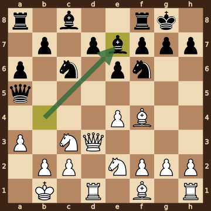
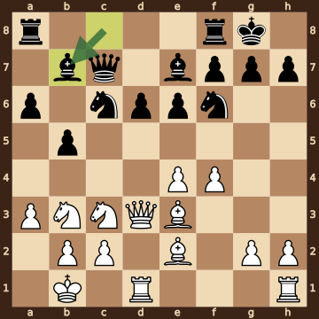
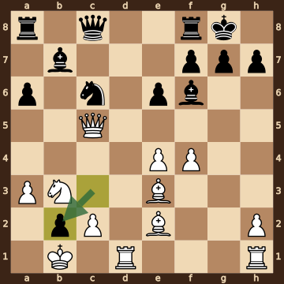
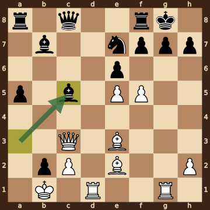
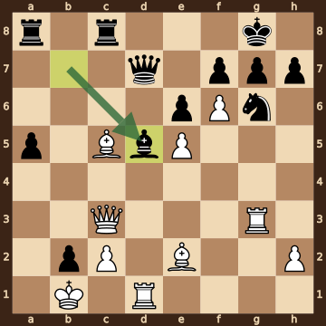
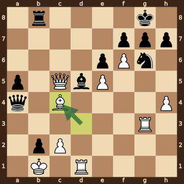
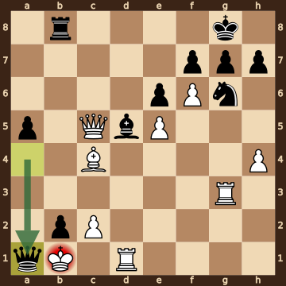

Radovanovic,Mihajlo (2374) – Bharath,Subramaniyam H (2603) · TCh-SRB Super Liga 2026, round 11, 2026.10.14. The game ends in checkmate on move 34. [Download the PGN](game.pgn)

Read each step's moves, play them **in your head** (no board!), then click the cards to check yourself. Board pictures only appear inside the answers — and once, after step 2.



### Step 1 · Moves 1–5




| | Pawns (moved ones in **bold**) | Count |
|---|---|---|
| White | a2 b2 c2 **e4** f2 g2 h2 | 7 |
| Black | a7 b7 d7 **e6** f7 g7 h7 | 7 |

In the center (c- to f-files, ranks 3–6): White e4; Black e6.



**White:** queen **d3**, knight **c3**.

**Black:** knight **c6**, knight **f6**.

Gone from the board: White has lost 1 pawn; Black has lost 1 pawn.


### Step 2 · Moves 6–10




| | Pawns (moved ones in **bold**) | Count |
|---|---|---|
| White | **a3** b2 c2 **e4** f2 g2 h2 | 7 |
| Black | **a6** b7 d7 **e6** f7 g7 h7 | 7 |

In the center (c- to f-files, ranks 3–6): White e4; Black e6.



**White:** king **b1**, queen **d3**, rook **d1**, bishop **f4**, knight **c3**, knight **e2**.

**Black:** king **g8**, queen **a5**, rook **f8**, bishop **e7**, knight **c6**, knight **f6**.

Gone from the board: White has lost 1 pawn; Black has lost 1 pawn.



**White king: b1** — castled queenside.

**Black king: g8** — castled kingside.



**No file is fully open** — every file still has a pawn on it.

Half open for White (only a Black pawn on it): d-file.

Half open for Black (only a White pawn on it): c-file.


**Check your picture** — the position after 10...Be7:

### Step 3 · Moves 11–15




| | White | Black |
|---|---|---|
| Pawns | a3 b2 c2 e4 f4 g2 h2 | a6 b5 d6 e6 f7 g7 h7 |
| Knights | b3 c3 | c6 f6 |
| Bishops | e2 e3 | b7 e7 |
| Rooks | d1 h1 | a8 f8 |
| Queen | d3 | c7 |
| King | b1 | g8 |




White's king is on **b1**.

Its own pieces close by: queen **d3**, rook **d1**, knight **b3**, knight **c3**, pawn **a3**, pawn **b2**, pawn **c2**.

Black pieces close by: none.

Squares next to the king that Black already hits: none.



**White:** rook **h1**. Pawns still at home: b2 c2 g2 h2.

**Black:** rook **a8**. Pawns still at home: f7 g7 h7.


### Step 4 · Moves 16–20




| | White | Black |
|---|---|---|
| Pawns | a3 c2 e4 f4 h2 | a6 b2 e6 f7 g7 h7 |
| Knights | b3 | c6 |
| Bishops | e2 e3 | b7 f6 |
| Rooks | d1 h1 | a8 f8 |
| Queen | c5 | c8 |
| King | b1 | g8 |




**Black is ahead by 1 point.**

| | Pieces | Points |
|---|---|---|
| White | Q, 2R, 2B, N, 5 pawns | 33 |
| Black | Q, 2R, 2B, N, 6 pawns | 34 |

(Pawn 1, knight 3, bishop 3, rook 5, queen 9.)



**White king: b1** — castled queenside.

**Black king: g8** — castled kingside.


### Step 5 · Moves 21–25




| | White | Black |
|---|---|---|
| Pawns | c2 e5 f5 h2 | a5 b2 e6 f7 g7 h7 |
| Knights | — | e7 |
| Bishops | e2 e3 | b7 c5 |
| Rooks | d1 g1 | a8 f8 |
| Queen | c3 | c8 |
| King | b1 | g8 |




**Open files** (no pawns at all): d-file.

Half open for White (only a Black pawn on it): a-file, b-file, g-file.

Half open for Black (only a White pawn on it): c-file.

Already on an open file: White rook d1.



**White:** none — every piece has moved. Pawns still at home: c2 h2.

**Black:** rook **a8**. Pawns still at home: f7 g7 h7.


### Step 6 · Moves 26–30




| | White | Black |
|---|---|---|
| Pawns | c2 e5 f6 h2 | a5 b2 e6 f7 g7 h7 |
| Knights | — | g6 |
| Bishops | c5 e2 | d5 |
| Rooks | d1 g3 | a8 c8 |
| Queen | c3 | d7 |
| King | b1 | g8 |




White's king is on **b1**.

Its own pieces close by: queen **c3**, rook **d1**, pawn **c2**.

Black pieces close by: pawn **b2**.

Squares next to the king that Black already hits: a1 (pawn b2); a2 (bishop d5); c1 (pawn b2).



**27.Bxc5** took a bishop on c5.


### Step 7 · Moves 31–34




| | White | Black |
|---|---|---|
| Pawns | c2 e5 f6 h4 | a5 b2 e6 f7 g7 h7 |
| Knights | — | g6 |
| Bishops | c4 | d5 |
| Rooks | d1 g3 | b8 |
| Queen | c5 | a4 |
| King | b1 | g8 |




**Material is equal.**

| | Pieces | Points |
|---|---|---|
| White | Q, 2R, B, 4 pawns | 26 |
| Black | Q, R, B, N, 6 pawns | 26 |

(Pawn 1, knight 3, bishop 3, rook 5, queen 9.)



White's king is on **b1**.

Its own pieces close by: rook **d1**, pawn **c2**.

Black pieces close by: pawn **b2**.

Squares next to the king that Black already hits: a1 (pawn b2, queen a4); a2 (queen a4); b2 (rook b8); c1 (pawn b2); c2 (queen a4).


### Final question




Check from the queen on a1.

The White king on b1 has no square to go to:

- **a1** — the Black queen stands there, protected by the pawn on b2
- **a2** — covered by the queen on a1
- **b2** — the Black pawn stands there, protected by the queen on a1 and the rook on b8
- **c1** — covered by the queen on a1 and the pawn on b2
- **c2** — blocked by its own pawn

The king can't take the queen — it is protected by the pawn on b2.


