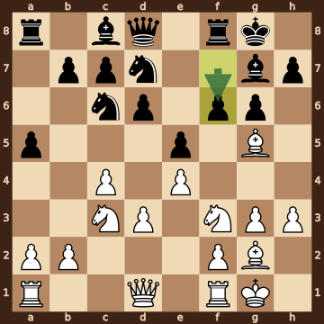
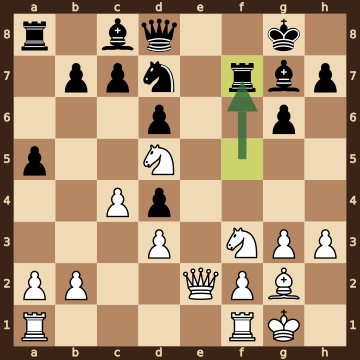
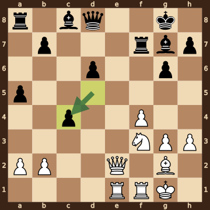
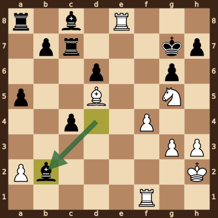
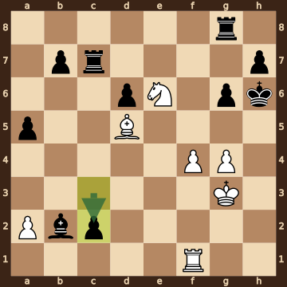
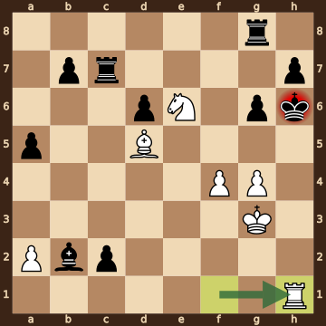

Rapport,R (2711) – Radovanovic,Mihajlo (2374) · 41st ECC Open 2026, round 2.1, 2026.10.18. The game ends in checkmate on move 31. [Download the PGN](game.pgn)

Read each step's moves, play them **in your head** (no board!), then click the cards to check yourself. Board pictures only appear inside the answers — and once, after step 2.



### Step 1 · Moves 1–5




| | Pawns (moved ones in **bold**) | Count |
|---|---|---|
| White | a2 b2 **c4** d2 e2 f2 **g3** h2 | 8 |
| Black | a7 b7 c7 **d6** e7 f7 **g6** h7 | 8 |

In the center (c- to f-files, ranks 3–6): White c4; Black d6.



**White:** bishop **g2**, knight **c3**, knight **f3**.

**Black:** king **g8**, rook **f8**, bishop **g7**, knight **f6**.


### Step 2 · Moves 6–10




| | Pawns (moved ones in **bold**) | Count |
|---|---|---|
| White | a2 b2 **c4** **d3** **e4** f2 **g3** **h3** | 8 |
| Black | **a5** b7 c7 **d6** **e5** **f6** **g6** h7 | 8 |

In the center (c- to f-files, ranks 3–6): White c4 d3 e4; Black d6 e5 f6.



**White:** king **g1**, rook **f1**, bishop **g2**, bishop **g5**, knight **c3**, knight **f3**.

**Black:** king **g8**, rook **f8**, bishop **g7**, knight **c6**, knight **d7**.



**White king: g1** — castled kingside.

**Black king: g8** — castled kingside.



**No file is fully open** — every file still has a pawn on it.


**Check your picture** — the position after 10...f6:

### Step 3 · Moves 11–15




| | White | Black |
|---|---|---|
| Pawns | a2 b2 c4 d3 f2 g3 h3 | a5 b7 c7 d4 d6 g6 h7 |
| Knights | d5 f3 | d7 |
| Bishops | g2 | c8 g7 |
| Rooks | a1 f1 | a8 f7 |
| Queen | e2 | d8 |
| King | g1 | g8 |




Black's king is on **g8**.

Its own pieces close by: rook **f7**, bishop **g7**, pawn **g6**, pawn **h7**.

White pieces close by: none.

Squares next to the king that White already hits: none.



**13.Bxd4** took a knight on d4.

**13...exd4** took a bishop on d4.

**14.exf5** took a pawn on f5.

**14...Rxf5** took a pawn on f5.


### Step 4 · Moves 16–20




| | White | Black |
|---|---|---|
| Pawns | a2 b2 f4 g3 h3 | a5 b7 c4 d6 g6 h7 |
| Knights | f3 | — |
| Bishops | g2 | c8 g7 |
| Rooks | e1 f1 | a8 f7 |
| Queen | e2 | d8 |
| King | g1 | g8 |




**Black is ahead by 1 point.**

| | Pieces | Points |
|---|---|---|
| White | Q, 2R, B, N, 5 pawns | 30 |
| Black | Q, 2R, 2B, 6 pawns | 31 |

(Pawn 1, knight 3, bishop 3, rook 5, queen 9.)



**White king: g1** — castled kingside.

**Black king: g8** — castled kingside.


### Step 5 · Moves 21–25




| | White | Black |
|---|---|---|
| Pawns | a2 f4 g3 h3 | a5 b7 c4 d6 g6 h7 |
| Knights | g5 | — |
| Bishops | d5 | b2 c8 |
| Rooks | e8 f1 | a8 c7 |
| Queen | — | — |
| King | h2 | g7 |




**Open files** (no pawns at all): e-file.

Half open for White (only a Black pawn on it): b-file, c-file, d-file.

Half open for Black (only a White pawn on it): f-file.

Already on an open file: White rook e8.



**White:** none — every piece has moved. Pawns still at home: a2.

**Black:** rook **a8**, bishop **c8**. Pawns still at home: b7 h7.


### Step 6 · Moves 26–30




| | White | Black |
|---|---|---|
| Pawns | a2 f4 g4 | a5 b7 c2 d6 g6 h7 |
| Knights | e6 | — |
| Bishops | d5 | b2 |
| Rooks | f1 | c7 g8 |
| Queen | — | — |
| King | g3 | h6 |




**Black is ahead by 5 points.**

| | Pieces | Points |
|---|---|---|
| White | R, B, N, 3 pawns | 14 |
| Black | 2R, B, 6 pawns | 19 |

(Pawn 1, knight 3, bishop 3, rook 5, queen 9.)



Black's king is on **h6**.

Its own pieces close by: rook **g8**, pawn **g6**, pawn **h7**.

White pieces close by: pawn **f4**, pawn **g4**.

Squares next to the king that White already hits: g5 (pawn f4, knight e6); g7 (knight e6); h5 (pawn g4).


### Final question




Check from the rook on h1.

The Black king on h6 has no square to go to:

- **g5** — covered by the knight on e6 and the pawn on f4
- **g6** — blocked by its own pawn
- **g7** — covered by the knight on e6
- **h5** — covered by the pawn on g4 and the rook on h1
- **h7** — blocked by its own pawn

Nothing can take the rook. Nothing can step in between on h2 h3 h4 h5.


