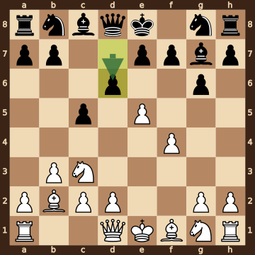
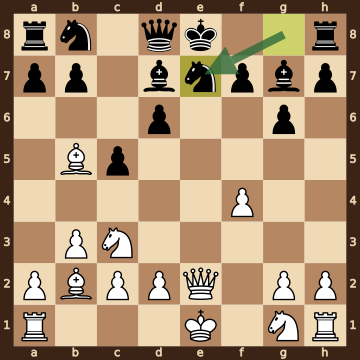
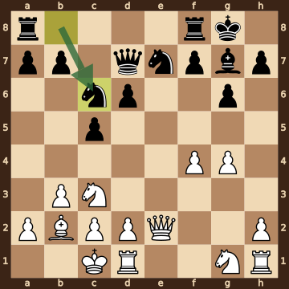
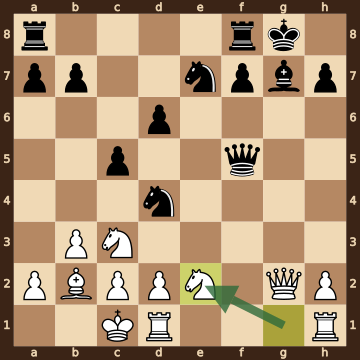
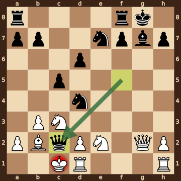

Reprintsev,A (2264) – Hengen,Luke O (2083) · Titled Tue 13th Oct 2026, round 2, 2026.10.13. The game ends in checkmate on move 16. [Download the PGN](game.pgn)

Read each step's moves, play them **in your head** (no board!), then click the cards to check yourself. Board pictures only appear inside the answers — and once, after step 2.



### Step 1 · Moves 1–3




| | Pawns (moved ones in **bold**) | Count |
|---|---|---|
| White | a2 **b3** c2 d2 **e4** f2 g2 h2 | 8 |
| Black | a7 b7 **c5** d7 e7 f7 **g6** h7 | 8 |

In the center (c- to f-files, ranks 3–6): White e4; Black c5.



**White:** bishop **b2**.

**Black:** knight **f6**.


### Step 2 · Moves 4–6




| | Pawns (moved ones in **bold**) | Count |
|---|---|---|
| White | a2 **b3** c2 d2 **e5** **f4** g2 h2 | 8 |
| Black | a7 b7 **c5** **d6** e7 f7 **g6** h7 | 8 |

In the center (c- to f-files, ranks 3–6): White e5 f4; Black c5 d6.



**White:** bishop **b2**, knight **c3**.

**Black:** bishop **g7**, knight **g8**.



**White king: e1** — still on its starting square, not castled.

**Black king: e8** — still on its starting square, not castled.



**No file is fully open** — every file still has a pawn on it.


**Check your picture** — the position after 6...d6:

### Step 3 · Moves 7–9




| | White | Black |
|---|---|---|
| Pawns | a2 b3 c2 d2 f4 g2 h2 | a7 b7 c5 d6 f7 g6 h7 |
| Knights | c3 g1 | b8 e7 |
| Bishops | b2 b5 | d7 g7 |
| Rooks | a1 h1 | a8 h8 |
| Queen | e2 | d8 |
| King | e1 | e8 |




White's king is on **e1**.

Its own pieces close by: queen **e2**, knight **c3**, knight **g1**, pawn **c2**, pawn **d2**, pawn **g2**.

Black pieces close by: none.

Squares next to the king that Black already hits: none.



**7.exd6** took a pawn on d6.

**7...exd6** took a pawn on d6.


### Step 4 · Moves 10–12




| | White | Black |
|---|---|---|
| Pawns | a2 b3 c2 d2 f4 g4 h2 | a7 b7 c5 d6 f7 g6 h7 |
| Knights | c3 g1 | c6 e7 |
| Bishops | b2 | g7 |
| Rooks | d1 h1 | a8 f8 |
| Queen | e2 | d7 |
| King | c1 | g8 |




**Material is equal.**

| | Pieces | Points |
|---|---|---|
| White | Q, 2R, B, 2N, 7 pawns | 35 |
| Black | Q, 2R, B, 2N, 7 pawns | 35 |

(Pawn 1, knight 3, bishop 3, rook 5, queen 9.)



**White king: c1** — castled queenside.

**Black king: g8** — castled kingside.


### Step 5 · Moves 13–16




| | White | Black |
|---|---|---|
| Pawns | a2 b3 c2 d2 h2 | a7 b7 c5 d6 f7 h7 |
| Knights | c3 e2 | d4 e7 |
| Bishops | b2 | g7 |
| Rooks | d1 h1 | a8 f8 |
| Queen | g2 | f5 |
| King | c1 | g8 |




**Black is ahead by 1 point.**

| | Pieces | Points |
|---|---|---|
| White | Q, 2R, B, 2N, 5 pawns | 33 |
| Black | Q, 2R, B, 2N, 6 pawns | 34 |

(Pawn 1, knight 3, bishop 3, rook 5, queen 9.)



White's king is on **c1**.

Its own pieces close by: rook **d1**, bishop **b2**, knight **c3**, knight **e2**, pawn **a2**, pawn **b3**, pawn **c2**, pawn **d2**.

Black pieces close by: none.

Squares next to the king that Black already hits: c2 (knight d4, queen f5).


### Final question




Check from the queen on c2.

The White king on c1 has no square to go to:

- **b1** — covered by the queen on c2
- **b2** — blocked by its own bishop
- **c2** — the Black queen stands there, protected by the knight on d4
- **d1** — blocked by its own rook
- **d2** — blocked by its own pawn

The king can't take the queen — it is protected by the knight on d4.


