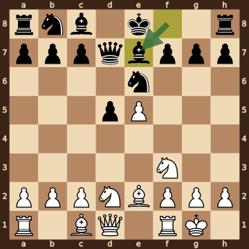
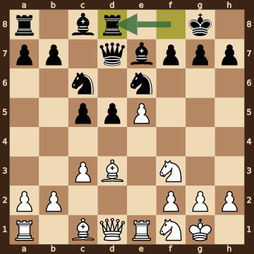
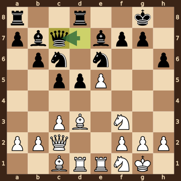
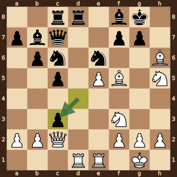
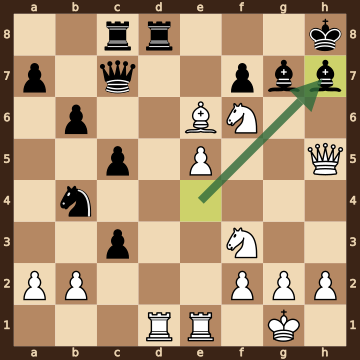
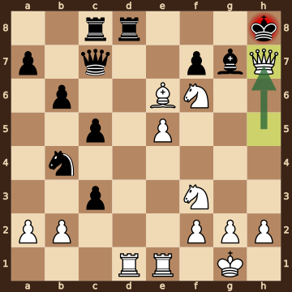

Seul,G (2342) – Taams,Lisanne (1986) · 28th Hoogeveen Open 2026, round 8.9, 2026.10.17. The game ends in checkmate on move 26. [Download the PGN](game.pgn)

Read each step's moves, play them **in your head** (no board!), then click the cards to check yourself. Board pictures only appear inside the answers — and once, after step 2.



### Step 1 · Moves 1–4




| | Pawns (moved ones in **bold**) | Count |
|---|---|---|
| White | a2 b2 c2 **e5** f2 g2 h2 | 7 |
| Black | a7 b7 c7 **d5** f7 g7 h7 | 7 |

In the center (c- to f-files, ranks 3–6): White e5; Black d5.



**White:** knight **f3**.

**Black:** knight **e4**.

Gone from the board: White has lost 1 pawn; Black has lost 1 pawn.


### Step 2 · Moves 5–8




| | Pawns (moved ones in **bold**) | Count |
|---|---|---|
| White | a2 b2 c2 **e5** f2 g2 h2 | 7 |
| Black | a7 b7 c7 **d5** f7 g7 h7 | 7 |

In the center (c- to f-files, ranks 3–6): White e5; Black d5.



**White:** king **g1**, rook **f1**, bishop **e2**, knight **d2**, knight **f3**.

**Black:** queen **d7**, bishop **e7**, knight **e6**.

Gone from the board: White has lost 1 pawn; Black has lost 1 pawn.



**White king: g1** — castled kingside.

**Black king: e8** — still on its starting square, not castled.



**No file is fully open** — every file still has a pawn on it.

Half open for White (only a Black pawn on it): d-file.

Half open for Black (only a White pawn on it): e-file.


**Check your picture** — the position after 8...Be7:

### Step 3 · Moves 9–12




| | White | Black |
|---|---|---|
| Pawns | a2 b2 c3 e5 f2 g2 h2 | a7 b7 c5 d5 f7 g7 h7 |
| Knights | f1 f3 | c6 e6 |
| Bishops | c1 d3 | c8 e7 |
| Rooks | a1 e1 | a8 d8 |
| Queen | d1 | d7 |
| King | g1 | g8 |




Black's king is on **g8**.

Its own pieces close by: bishop **e7**, knight **e6**, pawn **f7**, pawn **g7**, pawn **h7**.

White pieces close by: none.

Squares next to the king that White already hits: h7 (bishop d3).



**White:** queen **d1**, rook **a1**, bishop **c1**. Pawns still at home: a2 b2 f2 g2 h2.

**Black:** rook **a8**, bishop **c8**. Pawns still at home: a7 b7 f7 g7 h7.


### Step 4 · Moves 13–16




| | White | Black |
|---|---|---|
| Pawns | a2 b2 c3 e5 f2 g2 h2 | a7 b6 c5 d5 f7 g7 h6 |
| Knights | f1 f3 | c6 e6 |
| Bishops | c1 d3 | b7 e7 |
| Rooks | d1 e1 | a8 d8 |
| Queen | c2 | c7 |
| King | g1 | g8 |




**Material is equal.**

| | Pieces | Points |
|---|---|---|
| White | Q, 2R, 2B, 2N, 7 pawns | 38 |
| Black | Q, 2R, 2B, 2N, 7 pawns | 38 |

(Pawn 1, knight 3, bishop 3, rook 5, queen 9.)



**White king: g1** — castled kingside.

**Black king: g8** — castled kingside.


### Step 5 · Moves 17–20




| | White | Black |
|---|---|---|
| Pawns | a2 b2 e5 f2 g2 h2 | a7 b6 c3 c5 f7 g7 |
| Knights | f3 h5 | c6 e6 |
| Bishops | f5 h6 | b7 f8 |
| Rooks | d1 e1 | c8 d8 |
| Queen | c2 | c7 |
| King | g1 | g8 |




**Open files** (no pawns at all): d-file.

Half open for White (only a Black pawn on it): c-file.

Half open for Black (only a White pawn on it): e-file, h-file.

Already on an open file: White rook d1, Black rook d8.



**White:** none — every piece has moved. Pawns still at home: a2 b2 f2 g2 h2.

**Black:** none — every piece has moved. Pawns still at home: a7 f7 g7.


### Step 6 · Moves 21–25




| | White | Black |
|---|---|---|
| Pawns | a2 b2 e5 f2 g2 h2 | a7 b6 c3 c5 f7 |
| Knights | f3 f6 | b4 |
| Bishops | e6 | g7 h7 |
| Rooks | d1 e1 | c8 d8 |
| Queen | h5 | c7 |
| King | g1 | h8 |




**White is ahead by 1 point.**

| | Pieces | Points |
|---|---|---|
| White | Q, 2R, B, 2N, 6 pawns | 34 |
| Black | Q, 2R, 2B, N, 5 pawns | 33 |

(Pawn 1, knight 3, bishop 3, rook 5, queen 9.)



Black's king is on **h8**.

Its own pieces close by: bishop **g7**, bishop **h7**, pawn **f7**.

White pieces close by: knight **f6**.

Squares next to the king that White already hits: g8 (knight f6); h7 (queen h5, knight f6).


### Final question




Check from the queen on h7.

The Black king on h8 has no square to go to:

- **g7** — blocked by its own bishop
- **g8** — covered by the knight on f6 and the queen on h7
- **h7** — the White queen stands there, protected by the knight on f6

The king can't take the queen — it is protected by the knight on f6.


