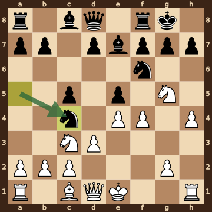
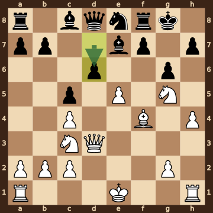
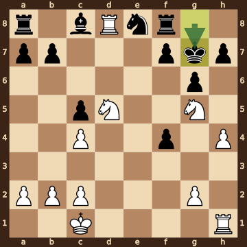
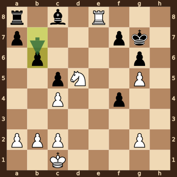
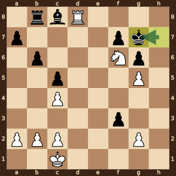
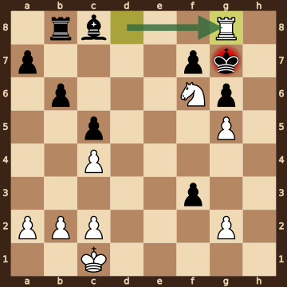

Timmermans,M (2419) – Marquardt,C (2023) · 36th NATO Chess 2026, round 5.6, 2026.10.15. The game ends in checkmate on move 25. [Download the PGN](game.pgn)

Read each step's moves, play them **in your head** (no board!), then click the cards to check yourself. Board pictures only appear inside the answers — and once, after step 2.



### Step 1 · Moves 1–4




| | Pawns (moved ones in **bold**) | Count |
|---|---|---|
| White | a2 b2 c2 d2 **e4** f2 g2 h2 | 8 |
| Black | a7 b7 **c5** d7 **e5** f7 g7 h7 | 8 |

In the center (c- to f-files, ranks 3–6): White e4; Black c5 e5.



**White:** bishop **c4**, knight **c3**, knight **f3**.

**Black:** bishop **e7**, knight **c6**.


### Step 2 · Moves 5–8




| | Pawns (moved ones in **bold**) | Count |
|---|---|---|
| White | a2 b2 c2 **d3** **e4** **f4** g2 **h4** | 8 |
| Black | a7 b7 **c5** d7 **e5** f7 g7 h7 | 8 |

In the center (c- to f-files, ranks 3–6): White d3 e4 f4; Black c5 e5.



**White:** knight **c3**, knight **g5**.

**Black:** king **g8**, rook **f8**, bishop **e7**, knight **c4**, knight **f6**.

Gone from the board: White has lost 1 bishop.



**White king: e1** — still on its starting square, not castled.

**Black king: g8** — castled kingside.



**No file is fully open** — every file still has a pawn on it.


**Check your picture** — the position after 8...Nxc4:

### Step 3 · Moves 9–12




| | White | Black |
|---|---|---|
| Pawns | a2 b2 c2 c4 e5 g2 h4 | a7 b7 c5 d6 f7 g6 h7 |
| Knights | c3 g5 | e8 |
| Bishops | f4 | c8 e7 |
| Rooks | a1 h1 | a8 f8 |
| Queen | d3 | d8 |
| King | e1 | g8 |




Black's king is on **g8**.

Its own pieces close by: rook **f8**, bishop **e7**, knight **e8**, pawn **f7**, pawn **g6**, pawn **h7**.

White pieces close by: none.

Squares next to the king that White already hits: f7 (knight g5); h7 (knight g5).



**9.dxc4** took a knight on c4.

**9...exf4** took a pawn on f4.

**12.Bxf4** took a pawn on f4.


### Step 4 · Moves 13–16




| | White | Black |
|---|---|---|
| Pawns | a2 b2 c2 c4 g2 h4 | a7 b7 c5 f4 f7 g6 h7 |
| Knights | d5 g5 | e8 |
| Bishops | — | c8 |
| Rooks | d8 h1 | a8 f8 |
| Queen | — | — |
| King | c1 | g7 |




**Black is ahead by 1 point.**

| | Pieces | Points |
|---|---|---|
| White | 2R, 2N, 6 pawns | 22 |
| Black | 2R, B, N, 7 pawns | 23 |

(Pawn 1, knight 3, bishop 3, rook 5, queen 9.)



**White king: c1** — castled queenside.

**Black king: g7** — castled kingside.


### Step 5 · Moves 17–20




| | White | Black |
|---|---|---|
| Pawns | a2 b2 c2 c4 g2 g5 | a7 b6 c5 f4 f7 g6 |
| Knights | d5 | — |
| Bishops | — | c8 |
| Rooks | e8 | a8 |
| Queen | — | — |
| King | c1 | g7 |




**Open files** (no pawns at all): d-file, e-file, h-file.

Half open for White (only a Black pawn on it): f-file.

Already on an open file: White rook e8.



**White:** none — every piece has moved. Pawns still at home: a2 b2 c2 g2.

**Black:** rook **a8**, bishop **c8**. Pawns still at home: a7 f7.


### Step 6 · Moves 21–24




| | White | Black |
|---|---|---|
| Pawns | a2 b2 c2 c4 g2 g5 | a7 b6 c5 f3 f7 g6 |
| Knights | f6 | — |
| Bishops | — | c8 |
| Rooks | d8 | b8 |
| Queen | — | — |
| King | c1 | g7 |




**Material is equal.**

| | Pieces | Points |
|---|---|---|
| White | R, N, 6 pawns | 14 |
| Black | R, B, 6 pawns | 14 |

(Pawn 1, knight 3, bishop 3, rook 5, queen 9.)



Black's king is on **g7**.

Its own pieces close by: pawn **f7**, pawn **g6**.

White pieces close by: knight **f6**, pawn **g5**.

Squares next to the king that White already hits: f6 (pawn g5); f8 (rook d8); g8 (knight f6, rook d8); h6 (pawn g5); h7 (knight f6); h8 (rook d8).


### Final question




Check from the rook on g8.

The Black king on g7 has no square to go to:

- **f6** — the White knight stands there, protected by the pawn on g5
- **f7** — blocked by its own pawn
- **f8** — covered by the rook on g8
- **g6** — blocked by its own pawn
- **g8** — the White rook stands there, protected by the knight on f6
- **h6** — covered by the pawn on g5
- **h7** — covered by the knight on f6
- **h8** — covered by the rook on g8

The king can't take the rook — it is protected by the knight on f6.


