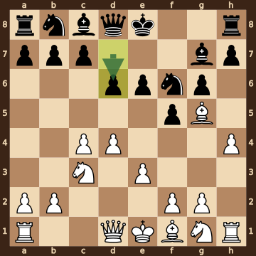
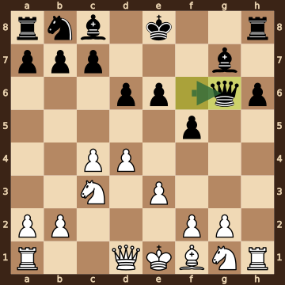
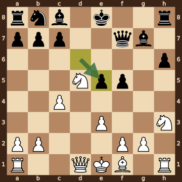
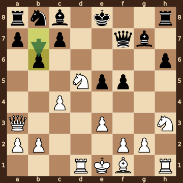
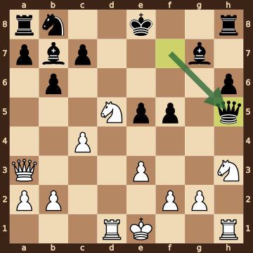
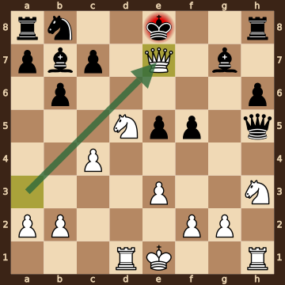

Yen,William (1994) – Sun,Yubo · Xinghua CCA Master 2026, round 1.8, 2026.10.16. The game ends in checkmate on move 18. [Download the PGN](game.pgn)

Read each step's moves, play them **in your head** (no board!), then click the cards to check yourself. Board pictures only appear inside the answers — and once, after step 2.



### Step 1 · Moves 1–3




| | Pawns (moved ones in **bold**) | Count |
|---|---|---|
| White | a2 b2 **c4** **d4** e2 f2 g2 h2 | 8 |
| Black | a7 b7 c7 d7 e7 **f5** **g6** h7 | 8 |

In the center (c- to f-files, ranks 3–6): White c4 d4; Black f5.



**White:** knight **c3**.

**Black:** bishop **g7**.


### Step 2 · Moves 4–6




| | Pawns (moved ones in **bold**) | Count |
|---|---|---|
| White | a2 b2 **c4** **d4** **e3** f2 g2 **h4** | 8 |
| Black | a7 b7 c7 **d6** **e6** **f5** **g6** h7 | 8 |

In the center (c- to f-files, ranks 3–6): White c4 d4 e3; Black d6 e6 f5.



**White:** bishop **g5**, knight **c3**.

**Black:** bishop **g7**, knight **f6**.



**White king: e1** — still on its starting square, not castled.

**Black king: e8** — still on its starting square, not castled.



**No file is fully open** — every file still has a pawn on it.


**Check your picture** — the position after 6...d6:

### Step 3 · Moves 7–9




| | White | Black |
|---|---|---|
| Pawns | a2 b2 c4 d4 e3 f2 g2 | a7 b7 c7 d6 e6 f5 h6 |
| Knights | c3 g1 | b8 |
| Bishops | f1 | c8 g7 |
| Rooks | a1 h1 | a8 h8 |
| Queen | d1 | g6 |
| King | e1 | e8 |




Black's king is on **e8**.

Its own pieces close by: queen **g6**, bishop **c8**, bishop **g7**, pawn **c7**, pawn **d6**, pawn **e6**.

White pieces close by: none.

Squares next to the king that White already hits: none.



**8.Bxf6** took a knight on f6.

**8...Qxf6** took a bishop on f6.

**9.hxg6** took a pawn on g6.

**9...Qxg6** took a pawn on g6.


### Step 4 · Moves 10–12




| | White | Black |
|---|---|---|
| Pawns | a2 b2 c4 e3 f2 g2 | a7 b7 c7 e5 f5 h6 |
| Knights | d5 h3 | b8 |
| Bishops | f1 | c8 g7 |
| Rooks | a1 h1 | a8 h8 |
| Queen | d1 | f7 |
| King | e1 | e8 |




**Material is equal.**

| | Pieces | Points |
|---|---|---|
| White | Q, 2R, B, 2N, 6 pawns | 34 |
| Black | Q, 2R, 2B, N, 6 pawns | 34 |

(Pawn 1, knight 3, bishop 3, rook 5, queen 9.)



**White king: e1** — still on its starting square, not castled.

**Black king: e8** — still on its starting square, not castled.


### Step 5 · Moves 13–15




| | White | Black |
|---|---|---|
| Pawns | a2 b2 c4 e3 f2 g2 | a7 b6 c7 e5 f5 h6 |
| Knights | d5 h3 | b8 |
| Bishops | f1 | c8 g7 |
| Rooks | d1 h1 | a8 h8 |
| Queen | a3 | f7 |
| King | e1 | e8 |




**Open files** (no pawns at all): d-file.

Half open for White (only a Black pawn on it): h-file.

Half open for Black (only a White pawn on it): g-file.

Already on an open file: White rook d1.



**White:** king **e1**, rook **h1**, bishop **f1**. Pawns still at home: a2 b2 f2 g2.

**Black:** rook **a8**, rook **h8**, bishop **c8**, knight **b8**. Pawns still at home: a7 c7.


### Step 6 · Moves 16–17




| | White | Black |
|---|---|---|
| Pawns | a2 b2 c4 e3 f2 g2 | a7 b6 c7 e5 f5 h6 |
| Knights | d5 h3 | b8 |
| Bishops | — | b7 g7 |
| Rooks | d1 h1 | a8 h8 |
| Queen | a3 | h5 |
| King | e1 | e8 |




**Black is ahead by 3 points.**

| | Pieces | Points |
|---|---|---|
| White | Q, 2R, 2N, 6 pawns | 31 |
| Black | Q, 2R, 2B, N, 6 pawns | 34 |

(Pawn 1, knight 3, bishop 3, rook 5, queen 9.)



Black's king is on **e8**.

Its own pieces close by: bishop **g7**, pawn **c7**.

White pieces close by: none.

Squares next to the king that White already hits: e7 (queen a3, knight d5); f8 (queen a3).


### Final question




Check from the queen on e7.

The Black king on e8 has no square to go to:

- **d7** — covered by the queen on e7
- **d8** — covered by the queen on e7
- **e7** — the White queen stands there, protected by the knight on d5
- **f7** — covered by the queen on e7
- **f8** — covered by the queen on e7

The king can't take the queen — it is protected by the knight on d5.


