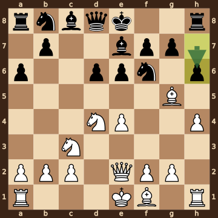
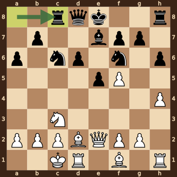
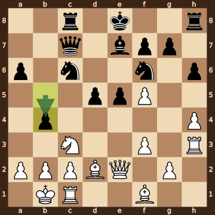
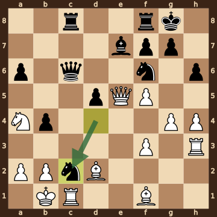
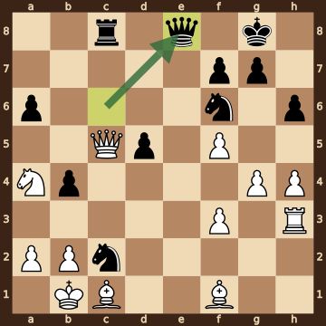
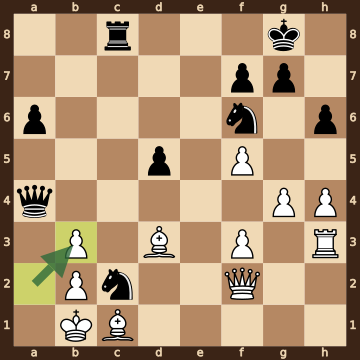
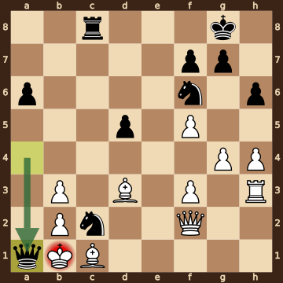

Yip,Carissa (2484) – Cervantes Landeiro,Thalia (2247) · ch-USA w 2026, round 8.5, 2026.10.17. The game ends in checkmate on move 27. [Download the PGN](game.pgn)

Read each step's moves, play them **in your head** (no board!), then click the cards to check yourself. Board pictures only appear inside the answers — and once, after step 2.



### Step 1 · Moves 1–4




| | Pawns (moved ones in **bold**) | Count |
|---|---|---|
| White | a2 b2 c2 **e4** f2 g2 h2 | 7 |
| Black | a7 b7 **d6** e7 f7 g7 h7 | 7 |

In the center (c- to f-files, ranks 3–6): White e4; Black d6.



**White:** knight **d4**.

**Black:** knight **f6**.

Gone from the board: White has lost 1 pawn; Black has lost 1 pawn.


### Step 2 · Moves 5–8




| | Pawns (moved ones in **bold**) | Count |
|---|---|---|
| White | a2 b2 c2 **e4** f2 g2 **h4** | 7 |
| Black | **a6** b7 **d6** **e6** f7 g7 **h6** | 7 |

In the center (c- to f-files, ranks 3–6): White e4; Black d6 e6.



**White:** queen **e2**, bishop **g5**, knight **c3**, knight **d4**.

**Black:** bishop **e7**, knight **f6**.

Gone from the board: White has lost 1 pawn; Black has lost 1 pawn.



**White king: e1** — still on its starting square, not castled.

**Black king: e8** — still on its starting square, not castled.



**No file is fully open** — every file still has a pawn on it.

Half open for White (only a Black pawn on it): d-file.

Half open for Black (only a White pawn on it): c-file.


**Check your picture** — the position after 8...h6:

### Step 3 · Moves 9–12




| | White | Black |
|---|---|---|
| Pawns | a2 b2 c2 f2 f5 g2 h4 | a6 b7 d6 e5 f7 g7 h6 |
| Knights | c3 | c6 f6 |
| Bishops | d2 f1 | e7 |
| Rooks | d1 h1 | c8 h8 |
| Queen | e2 | d8 |
| King | c1 | e8 |




White's king is on **c1**.

Its own pieces close by: queen **e2**, rook **d1**, bishop **d2**, knight **c3**, pawn **a2**, pawn **b2**, pawn **c2**.

Black pieces close by: none.

Squares next to the king that Black already hits: none.



**10...Bxf5** took a knight on f5.

**11.exf5** took a bishop on f5.


### Step 4 · Moves 13–16




| | White | Black |
|---|---|---|
| Pawns | a2 b2 c2 f3 f5 g2 h4 | a6 b4 d5 e5 f7 g7 h6 |
| Knights | c3 | c6 f6 |
| Bishops | d2 f1 | e7 |
| Rooks | c1 h3 | c8 h8 |
| Queen | e2 | c7 |
| King | b1 | e8 |




**Material is equal.**

| | Pieces | Points |
|---|---|---|
| White | Q, 2R, 2B, N, 7 pawns | 35 |
| Black | Q, 2R, B, 2N, 7 pawns | 35 |

(Pawn 1, knight 3, bishop 3, rook 5, queen 9.)



**White king: b1** — castled queenside.

**Black king: e8** — still on its starting square, not castled.


### Step 5 · Moves 17–20




| | White | Black |
|---|---|---|
| Pawns | a2 b2 f3 f5 g4 h4 | a6 b4 d5 f7 g7 h6 |
| Knights | a4 | c2 f6 |
| Bishops | d2 f1 | e7 |
| Rooks | c1 h3 | c8 f8 |
| Queen | e5 | c6 |
| King | b1 | g8 |




**Open files** (no pawns at all): c-file, e-file.

Half open for White (only a Black pawn on it): d-file.

Already on an open file: White rook c1, White queen e5, Black queen c6, Black rook c8.



**White:** bishop **f1**. Pawns still at home: a2 b2.

**Black:** none — every piece has moved. Pawns still at home: f7 g7.


### Step 6 · Moves 21–24




| | White | Black |
|---|---|---|
| Pawns | a2 b2 f3 f5 g4 h4 | a6 b4 d5 f7 g7 h6 |
| Knights | a4 | c2 f6 |
| Bishops | c1 f1 | — |
| Rooks | h3 | c8 |
| Queen | c5 | e8 |
| King | b1 | g8 |




White's king is on **b1**.

Its own pieces close by: bishop **c1**, pawn **a2**, pawn **b2**.

Black pieces close by: knight **c2**.

Squares next to the king that Black already hits: a1 (knight c2).



**21.Qxe7** took a bishop on e7.

**23...Rxc1+** took a rook on c1.

**24.Bxc1** took a rook on c1.


### Step 7 · Moves 25–27




| | White | Black |
|---|---|---|
| Pawns | b2 b3 f3 f5 g4 h4 | a6 d5 f7 g7 h6 |
| Knights | — | c2 f6 |
| Bishops | c1 d3 | — |
| Rooks | h3 | c8 |
| Queen | f2 | a4 |
| King | b1 | g8 |




**White is ahead by 1 point.**

| | Pieces | Points |
|---|---|---|
| White | Q, R, 2B, 6 pawns | 26 |
| Black | Q, R, 2N, 5 pawns | 25 |

(Pawn 1, knight 3, bishop 3, rook 5, queen 9.)



White's king is on **b1**.

Its own pieces close by: bishop **c1**, bishop **d3**, pawn **b2**, pawn **b3**.

Black pieces close by: knight **c2**.

Squares next to the king that Black already hits: a1 (knight c2, queen a4); a2 (queen a4); c2 (rook c8).


### Final question




Check from the queen on a1.

The White king on b1 has no square to go to:

- **a1** — the Black queen stands there, protected by the knight on c2
- **a2** — covered by the queen on a1
- **b2** — blocked by its own pawn
- **c1** — blocked by its own bishop
- **c2** — the Black knight stands there, protected by the rook on c8

The king can't take the queen — it is protected by the knight on c2.


